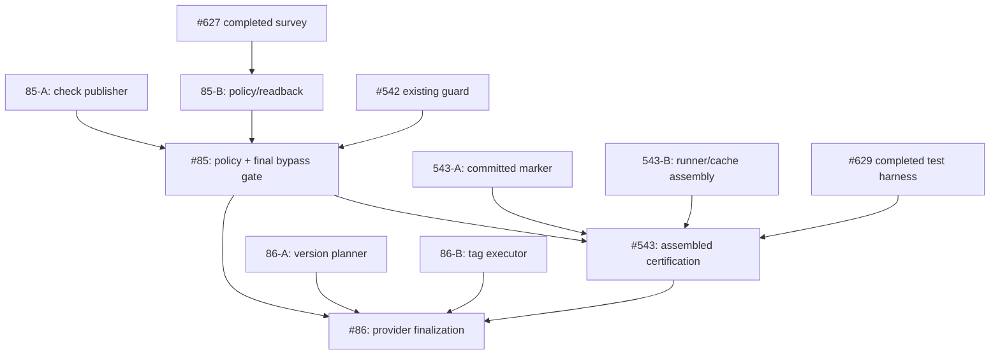

# Remaining-Work Decomposition and Failure-Prevention Audit

Status: proposed, non-authoritative until ticket graph is updated and tested.
Scope: #85, #543, #86, and the source PRs that feed them.
Date: 2026-10-10

## Failure-prevention requirements

The following are mandatory before dispatching parallel workers:

1. Read authoritative issue contracts and the canonical synchronized dependency
   graph.  Check that the actual provider tickets, graph, and descriptions agree.
   Reject missing nodes, reversed or invented dependencies, cycles, duplicate
   direct edges, and accidental transitive serialization.
2. Inventory completed tickets, existing open/draft PRs, file ownership, current
   V3 claims, prior checkpoints, and independently certified acceptance before
   creating any new leaf.  Do not reproduce another owner's implementation.
3. Derive the smallest coherent, independently verifiable behaviours.  Each new
   leaf has precise interface, positive/negative/lifecycle tests, source owner,
   failure/rollback semantics, and a distinct usable DONE artifact.
4. Verify parallelism against *real code and mutable-state surfaces*, not
   merely the appearance of separate nodes in a graph.  In particular, two
   workers editing the same runner or GitHub policy state are not safely
   parallel without explicit nonoverlapping boundaries.
5. Keep actual contract dependencies, but do not turn optional infrastructure
   or future security features into prerequisites.  #97's earlier detour
   through an offline signing ceremony and protected environments illustrates
   this failure.  #85's protected-main requirements are real and remain owned
   by #85, not retroactively imposed on #97.
6. Separate issue-level GREEN from assembled regression, actual hosted provider
   acceptance, branch protection, and final release certification.  Record
   exact SHA, environment, artifact, provider state and which cases are
   incomplete.  Do not interpret inherited #527/#535 renderer evidence failure
   as proof of failure in unrelated source; do not waive it at convergence.
7. An agent must establish and verify a unique V3 claim before source writes,
   keep its existing claim on continuation, and never silently create a
   competing claim or duplicate PR.  A progress update or CI start does not end
   an execution window; measure wall-clock elapsed time and continue actionable
   work, reserving genuine blocks for evidence-backed external limitations.
8. Parent tickets retain all original completion requirements after splitting.
   A small implementation ticket can be DONE independently, but parent
   integration/certification may not be DONE until the real assembled system
   passes its gates.  Speculative downstream work remains BLOCKED until direct
   prerequisites are complete and its assumptions are revalidated.
9. For graph visualizations, use a graph definition rendered by Mermaid, not
   manual positioned SVG lines.  Independently validate node/edge sets,
   reachability to terminal deliverables, arrows and acyclicity.  A connected
   drawing by itself does not prove contractual correctness.
10. Reconcile the agreed capability list with created GitHub issues, canonical
    graph records and actual branch owners before claiming decomposition done.
    Never merge or activate production workflows based merely on a draft plan.

## Evidence of already-owned work

- #627 is CLOSED: GitHub protection capability readback and refusal matrix;
  its provider enforcement cases were explicitly INCOMPLETE where inaccessible.
  Reuse PR #631; do not create another provider survey.
- #629 is CLOSED: 29-case convergence trace, preparatory tests and known
  committed-marker integration defect.  Reuse PR #633 and test-only probes
  #634/#635; they do not certify an assembled #543.
- #542's PR #546 contains premerge and GitHub provider-guard logic; its
  follow-up PR #603 adds a last-moment reread but documents the residual race.
  Do not create an independent second merge-guard owner.
- #85 already has a draft operator checklist PR #607.  Survey and rollout
  documentation do not configure GitHub server protection.
- #541 PR #547 owns unified hosted stages and provider cache reuse; #545 PR
  #552 owns public test CLI.  Do not recreate these as new implementation leaves.
- #543 PR #549 is partial assembled lifecycle certification and #629 provides
  independent preparatory coverage.  Actual convergence is outstanding.
- No current #86 source PR was established by this audit; confirm again when
  workers start before creating a new publisher.

## Suggested remainder (not yet canonical ticket IDs)

### #85: server enforced protected-main integration

- 85-A: exact-candidate required-check publisher: a narrow hosted/provider
  publication implementation, including trust, exact candidate and base
  binding, forged/stale/unavailable evidence rejection.  Only create if not
  owned by an existing PR after searching its patch.
- 85-B: GitHub-native policy rollout and provider readback: one independently
  testable provision/inspect interface plus refusal for unsupported settings,
  using #627's capability matrix.  Do not change production settings as a
  speculative test.
- 85-C: final protection/merge-gate convergence: reuse #542 PR #546/#603;
  execute real provider bypass and changed-base tests, check publisher/policy
  together, and retain #85 as final owner.  Must wait for A and B.

### #543: assembled on-demand CLI/hosted certification

- 543-A: committed invocation / tamper and retry acceptance over assembled
  source.  Reconcile #540's committed HEAD parser with #548; #629 recorded a
  reproducible RED source conflict.
- 543-B: unified stage runner and cache/evidence contract assembly: integrate
  already-owned #541/#545/#548 implementations; do not replace these PRs.
  Verify real immutable artifact reuse and source-change invalidation.
- 543-C: end-to-end certification: run #629's acceptance matrix over actual
  assembled candidate, all stages, three platforms, missing/forged evidence,
  missed-event retry, cost exclusions and #85 server-policy acceptance.
  Retain #543 as final owner.
- Candidate A and B may run in parallel *only* if write ownership and an
  explicit integration surface are disjoint.  Otherwise schedule sequentially
  within the existing #543 owner.

### #86: protected stable-version tag finalization

- 86-A: canonical version, tag collision and immutable tag decision planner
  (read-only; #118 and #80 contract inputs; negative tests).
- 86-B: remote provider finalization executor: only after accepted protected
  server main and authorization evidence; real SHA readback, tag create,
  idempotent retries, immutability/move/delete refusal.
- 86-C: provider-backed final acceptance and cleanup: real sandbox tag
  refusal/race/provider tests and #85/#543 convergence.  Final #86 gate remains
  blocked until both parents DONE.
- Planner and executor may develop separately against a fixed interface; do
  not falsely claim remote finalizer DONE before protected-main integration.

## Proposed dependency shape

All unit labels are provisional.  Existing completed ticket dependencies must
remain canonical.  Avoid duplicating transitive #85 to #86 graph edges unless
#86 independently requires the #85 protected-main interface (it currently
does).  Before creating new tickets: inspect active claims/PR changed files,
freeze actual interfaces and check that each unit is not already implemented.

## Acceptance of this audit

This document is guidance, not a ticket mutation.  It does not itself create
child tickets or update dependency graph state.  Follow TICKET_STATE.md to
create/sync any approved new leaves and verify readback; keep original parent
acceptance criteria unchanged.  No production merge, tag or workflow
activation is authorised by this analysis.
