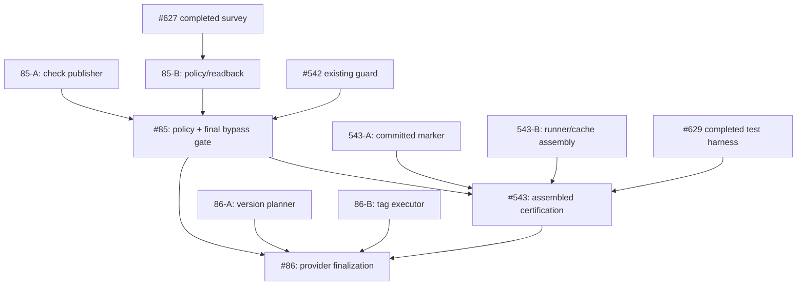

# Remaining-Work Decomposition and Failure-Prevention Audit

Status: proposed, non-authoritative until ticket graph is updated and tested.
Scope: #85, #543, #86, and the source PRs that feed them.
Date: 2026-10-10

## Failure-prevention requirements

The following are mandatory before dispatching parallel workers:

1. Read authoritative issue contracts and the canonical synchronized dependency
   graph.  Check that the actual provider tickets, graph, and descriptions agree.
   Reject missing nodes, reversed or invented dependencies, cycles, duplicate
   direct edges, and accidental transitive serialization.
2. Inventory completed tickets, existing open/draft PRs, file ownership, current
   V3 claims, prior checkpoints, and independently certified acceptance before
   creating any new leaf.  Do not reproduce another owner's implementation.
3. Derive the smallest coherent, independently verifiable behaviours.  Each new
   leaf has precise interface, positive/negative/lifecycle tests, source owner,
   failure/rollback semantics, and a distinct usable DONE artifact.
4. Verify parallelism against *real code and mutable-state surfaces*, not
   merely the appearance of separate nodes in a graph.  In particular, two
   workers editing the same runner or GitHub policy state are not safely
   parallel without explicit nonoverlapping boundaries.
5. Keep actual contract dependencies, but do not turn optional infrastructure
   or future security features into prerequisites.  #97's earlier detour
   through an offline signing ceremony and protected environments illustrates
   this failure.  #85's protected-main requirements are real and remain owned
   by #85, not retroactively imposed on #97.
6. Separate issue-level GREEN from assembled regression, actual hosted provider
   acceptance, branch protection, and final release certification.  Record
   exact SHA, environment, artifact, provider state and which cases are
   incomplete.  Do not interpret inherited #527/#535 renderer evidence failure
   as proof of failure in unrelated source; do not waive it at convergence.
7. An agent must establish and verify a unique V3 claim before source writes,
   keep its existing claim on continuation, and never silently create a
   competing claim or duplicate PR.  A progress update or CI start does not end
   an execution window; measure wall-clock elapsed time and continue actionable
   work, reserving genuine blocks for evidence-backed external limitations.
8. Parent tickets retain all original completion requirements after splitting.
   A small implementation ticket can be DONE independently, but parent
   integration/certification may not be DONE until the real assembled system
   passes its gates.  Speculative downstream work remains BLOCKED until direct
   prerequisites are complete and its assumptions are revalidated.
9. For graph visualizations, use a graph definition rendered by Mermaid, not
   manual positioned SVG lines.  Independently validate node/edge sets,
   reachability to terminal deliverables, arrows and acyclicity.  A connected
   drawing by itself does not prove contractual correctness.
10. Reconcile the agreed capability list with created GitHub issues, canonical
    graph records and actual branch owners before claiming decomposition done.
    Never merge or activate production workflows based merely on a draft plan.

## Evidence of already-owned work

- #627 is CLOSED: GitHub protection capability readback and refusal matrix;
  its provider enforcement cases were explicitly INCOMPLETE where inaccessible.
  Reuse PR #631; do not create another provider survey.
- #629 is CLOSED: 29-case convergence trace, preparatory tests and known
  committed-marker integration defect.  Reuse PR #633 and test-only probes
  #634/#635; they do not certify an assembled #543.
- #542's PR #546 contains premerge and GitHub provider-guard logic; its
  follow-up PR #603 adds a last-moment reread but documents the residual race.
  Do not create an independent second merge-guard owner.
- #85 already has a draft operator checklist PR #607.  Survey and rollout
  documentation do not configure GitHub server protection.
- #541 PR #547 owns unified hosted stages and provider cache reuse; #545 PR
  #552 owns public test CLI.  Do not recreate these as new implementation leaves.
- #543 PR #549 is partial assembled lifecycle certification and #629 provides
  independent preparatory coverage.  Actual convergence is outstanding.
- No current #86 source PR was established by this audit; confirm again when
  workers start before creating a new publisher.

## Suggested remainder (not yet canonical ticket IDs)

### #85: server enforced protected-main integration

- 85-A: exact-candidate required-check publisher: a narrow hosted/provider
  publication implementation, including trust, exact candidate and base
  binding, forged/stale/unavailable evidence rejection.  Only create if not
  owned by an existing PR after searching its patch.
- 85-B: GitHub-native policy rollout and provider readback: one independently
  testable provision/inspect interface plus refusal for unsupported settings,
  using #627's capability matrix.  Do not change production settings as a
  speculative test.
- 85-C: final protection/merge-gate convergence: reuse #542 PR #546/#603;
  execute real provider bypass and changed-base tests, check publisher/policy
  together, and retain #85 as final owner.  Must wait for A and B.

### #543: assembled on-demand CLI/hosted certification

- 543-A: committed invocation / tamper and retry acceptance over assembled
  source.  Reconcile #540's committed HEAD parser with #548; #629 recorded a
  reproducible RED source conflict.
- 543-B: unified stage runner and cache/evidence contract assembly: integrate
  already-owned #541/#545/#548 implementations; do not replace these PRs.
  Verify real immutable artifact reuse and source-change invalidation.
- 543-C: end-to-end certification: run #629's acceptance matrix over actual
  assembled candidate, all stages, three platforms, missing/forged evidence,
  missed-event retry, cost exclusions and #85 server-policy acceptance.
  Retain #543 as final owner.
- Candidate A and B may run in parallel *only* if write ownership and an
  explicit integration surface are disjoint.  Otherwise schedule sequentially
  within the existing #543 owner.

### #86: protected stable-version tag finalization

- 86-A: canonical version, tag collision and immutable tag decision planner
  (read-only; #118 and #80 contract inputs; negative tests).
- 86-B: remote provider finalization executor: only after accepted protected
  server main and authorization evidence; real SHA readback, tag create,
  idempotent retries, immutability/move/delete refusal.
- 86-C: provider-backed final acceptance and cleanup: real sandbox tag
  refusal/race/provider tests and #85/#543 convergence.  Final #86 gate remains
  blocked until both parents DONE.
- Planner and executor may develop separately against a fixed interface; do
  not falsely claim remote finalizer DONE before protected-main integration.

## Proposed dependency shape

All unit labels are provisional.  Existing completed ticket dependencies must
remain canonical.  Avoid duplicating transitive #85 to #86 graph edges unless
#86 independently requires the #85 protected-main interface (it currently
does).  Before creating new tickets: inspect active claims/PR changed files,
freeze actual interfaces and check that each unit is not already implemented.

## Acceptance of this audit

This document is guidance, not a ticket mutation.  It does not itself create
child tickets or update dependency graph state.  Follow TICKET_STATE.md to
create/sync any approved new leaves and verify readback; keep original parent
acceptance criteria unchanged.  No production merge, tag or workflow
activation is authorised by this analysis.

## Completed changed-file ownership audit (PR patch inventory)

This check inspects the **actual changed-file lists** of existing draft PRs,
not just PR descriptions.  It is a stronger ownership check than the initial
specification inventory.  It does not prove a feature is semantically complete;
that requires source-level review and acceptance tests.

| Area | Existing source owner(s) and concrete files | Decision |
| --- | --- | --- |
| Exact candidate eligibility | #104 PR #604: `repo_workflow/candidate_eligibility.py` and its tests | Reuse; no new eligibility leaf |
| Protected merge policy and stale reread | #542 PR #546: `repo_workflow/github_merge_guard.py`, `repo_workflow/pre_merge_gate.py`, `repo_workflow/github_evidence.py`, tests; follow-up PR #603 **also edits the same merge guard** | ONE integration owner; do not split A3 or create another merge guard |
| Protected-main provider capability/readback | #627 PR #631: `scripts/probe-provider-protection.py`, survey and tests; #85 PR #607: rollout checklist | Do not repeat survey/checklist; actual policy configuration/publisher remains unproven |
| Hosted stage runner | #541 PR #547: `.github/workflows/on-demand-ci.yml`, `scripts/on-demand-ci-plan.py`, `scripts/publish-hosted-result.py`, `repo_workflow/ci_invocation.py`, `repo_workflow/github_cache.py`, numerous tests | Reuse; no duplicate hosted-runner leaf |
| Unified CLI and stage engines | #545 PR #552: `repo_workflow/test_cli.py`, `public_cli.py`, `public_commands.py`, `test_cache.py`, `test_red_runner.py`, stage engines and tests | Reuse; no duplicate B1 implementation |
| Shared #541/#545 edits | Both #547 and #552 edit `repo_workflow/test_cli.py`, `public_cli.py`, `public_commands.py`, `test_cache.py`, `test_red_runner.py`, `WORK_GRAPH_METHODOLOGY.md`, `.ci/tests.json` and numerous test files | **Not independent branch-level work.** One controlled assembly owner with conflict-resolution tests is required |
| Cache | #548 PR #615: `repo_workflow/hosted_cache.py`; #541 PR #547: `repo_workflow/hosted_cache.py` and `github_cache.py` | Do not assign independent simultaneous cache writers; #543 must reconcile canonical implementation |
| Independent certification | #629 PR #633: ten test modules, `ISSUE629_CERTIFICATION_MATRIX.md`, fixture; #543 PR #549: `tests/test_on_demand_ci_certification.py` | Existing evidence owners; final assembled provider certification stays #543 |
| GitHub mutation adapter | #97 PR #616 owns `adapters/repo_host_github_*.py` and Python mutation tests | Completed upstream issue; do not regenerate adapter in #85 |
| Stable tag finalizer | None of PR #546/#547/#549/#552/#603/#604/#607/#615/#616/#631/#633/#634/#635 modifies a dedicated finalizer implementation.  #541/#545 touch `repo_workflow/terminal_tag.py`, which is **not** proof of a finished protected stable-tag publisher | #86 remains a real implementation gap, subject to a more targeted full repository search before code changes |

### Revised decomposition decision

1. **Withdraw the naive A1/A2/A3/B1-B5 parallel launch recommendation.**
   Parallel *requirements* do not imply separate concurrent writers when code
   overlaps.  In particular do not create new CLI, cache, merge-guard, provider
   survey, or acceptance-matrix tickets for already owned work.
2. **#85:** the only proposed independently ownable remaining source deliverable
   is a narrow trusted exact-candidate check publisher if source review confirms
   it does not already exist.  Actual GitHub branch protection configuration,
   enforcement readback and bypass certification belong to #85's final owner,
   because they mutate shared remote policy.  A policy provisioning interface
   may merit a separate leaf only after source/policy capability review proves a
   discrete deliverable; no unverified new dependency should be asserted.
3. **#543:** preserve a **single assembled source integration owner** for #541,
   #545, #548 and #542 conflicts, committed-marker reconciliation, cache reuse
   and certification.  A separate read-only independent acceptance worker may
   run #629 tests against a pinned assembled SHA, but must not modify shared
   source.  Do not split overlapping runner/cache edits across concurrent PRs.
4. **#86:** the best potential independent split remains (a) read-only version
   and eligibility planner and (b) remote stable-tag executor.  They can be
   implemented on disjoint modules only after the interface is frozen; final
   provider acceptance still requires #85 and #543.  Do not prematurely add
   either child as a direct parent completion prerequisite before canonical
   ticket graph validation.
5. **Missing evidence:** no source-level semantic review has yet established the
   exact implementation or absence of the required-check publisher or all
   #86 tag finalizer mechanics.  These remain *candidate* child tickets, not
   justified GitHub issue creation.  No child tickets or DAG edges were added.

### Pass/fail verdict on initial proposed launch

**FAIL:** simultaneous implementation of A3/B1/B2/B3/B4 by unrelated workers
would conflict with known existing PR ownership.  **PASS:** preserve one
#85 convergence owner, one #543 assembly owner, one #86 final owner, and reuse
#627/#629 independent evidence.  Proposed narrow publisher and #86 split need
further source- and contract-level verification before dispatch.

## Source-level gap verification and executed decomposition

Observed 2026-10-10, using exact file reads and existing PR diffs:

- #542 PR #546 `repo_workflow/github_merge_guard.py` checks the configured
  status context `repo-workflow/exact-candidate` before protected PR merging.
  This module invokes an evidence gate and the GitHub merge API; it does not
  publish the required named GitHub check.  Existing candidate eligibility
  `repo_workflow/candidate_eligibility.py` on #104 PR #604 is a pure verdict,
  not a GitHub check publisher.  Existing default-branch search for the exact
  required-check name and `create_check_run` returned no matches.  Together
  with the changed-file ownership inventory, this justifies the narrow
  provider check publisher #637.  It is not proof about unsearched private
  branches or out-of-band deployments; #637 must recheck before modifying.
- Main `repo_workflow/guard.py` already implements
  `validate_stable_candidate()`, including stable-version selection,
  authoritative integration-branch HEAD comparison and remote tag collision
  rejection.  Main `repo_workflow/results.py` implements
  `finalize_stable_results()`, including result evaluation and local tag
  creation/push.  `tests/test_stable_release.py` exercises the existing
  version, branch, collision, PASS and FAIL cases.  These do **not** establish
  remote-only, trusted #80 authorization, proven protected-main acceptance,
  atomic immutable stable-tag publication and independently read-back
  provider enforcement.  Consequently a proposed new version planner would
  duplicate source; #638 owns only the missing remote publisher boundary.
- #543 must remain a single source assembly owner because #541 PR #547 and
  #545 PR #552 modify the same public CLI, stage engines, cache, test catalogue
  and docs.  #629 remains independent acceptance evidence, not a competing
  implementation.  No new #543 source child was created.

Created provider tickets:
- #637: Publish GitHub exact-candidate required check from authenticated
  evidence. Direct dependencies #104, #110, #548. Exclusive new publisher
  code; #85 retains policy/readback/bypass certification.
- #638: Implement remote-only stable-tag publisher for accepted main SHA.
  Direct dependencies #80, #118. Exclusive new remote publisher code; #86
  retains final protected-main/convergence provider certification.

Parent provider issues #85 and #86 were amended with their new **direct**
completion edges. Draft PR #636 carries synchronized
`.repoworkflow/tickets.csv` changes. Since main's older CSV lacked recent
#538/#540/#541/#542/#543/#545/#548/#627/#628/#629 records, those were also
added using their authoritative provider titles. #85 depends on
#97/#104/#110/#542/#627/#637; #86 on #80/#85/#118/#543/#638.
#543 remains on #85 and existing CI component prerequisites. Do not treat
closed provider issue status as a substitute for repository lifecycle state.

The committed graph readback has 281 nodes, zero missing references, zero
duplicate direct edges, zero self edges, and zero directed cycles.
This is structural validation, not proof that every historical edge on the
previously incomplete CSV represents the latest provider dependency: all
synchronized issues should be checked against the provider as part of
the full ticket-sync acceptance run.

No new child for #543 and no provider-policy rollout child for #85 were
created: they would duplicate shared source ownership or be inseparable from
the final integration gate. This is an intentional decomposition decision,
not an omitted capability. No merge, release, tag or production activation.

## Stable-tag legacy defects: ownership and required acceptance

Source verification of default-branch `repo_workflow/guard.py` and
`repo_workflow/results.py` found two existing lifecycle defects/risks:

- `validate_stable_candidate()` deletes a pre-existing local stable tag ref,
  violating the expected read-only validation boundary.
- `finalize_stable_results(do_tag=True,push=True)` creates and publishes a
  tag from the local checkout, without exercising the intended remote-only
  authorized publisher of #86. Tag absence checked earlier is vulnerable to
  races; the existing module is not evidence of server-protected publication.

The original version selection and authoritative remote integration-head
checks already exist and should be preserved. #86 **owns regression-first
correction of existing guard/results code**, no extra ticket, including
pre/post local and remote refs, repeated and refused operations, entry-point
migration, and avoidance of an alternate legacy publication bypass. #638
owns only a **new remote-only** atomic create-if-absent publisher and its
independent provider tests; it must not edit guard/results. #86 retains
integration of #638, real provider certification, #80/#85/#543 gates.

Both issue bodies updated explicitly. Canonical dependency edges are unchanged
by this ownership clarification. These are now acceptance requirements, not
claims that implementation has been fixed.

## 2026-10-11 functional/security separation

User priority: RepoWorkflow primarily prevents omission and loss of task,
dependency, evidence, and handoff state. Production GitHub protection is a
separate security gate, not a prerequisite for functional hosted CI
certification.

- #85 stays OPEN and DEFERRED, with its V3 claim respected; missing GitHub
  administration permissions do not imply completion or permission to bypass.
- #543 direct prerequisites become #540/#541/#542/#545/#548/#629, dropping
  the #85 edge. Its provider-backed functional acceptance still tests CLI,
  stage execution, result persistence, provenance, races and recovery. Its
  security assertions are explicitly DEFERRED and must not be marked PASS.
- #86 continues to depend on #85, #543 and closed #638 plus #80/#118.
  Its legacy existing-code fixes can progress independently, but the
  protected production stable release cannot be certified prematurely.
- Future opt-in `rwf init repo` may use `repo-info` for capability discovery
  and provider-specific configuration; no implementation or production
  activation is implied by this scheduling decision.
- This graph revision does not merge any PR or release production tags.

Graph CSV validated: 281 unique nodes, 499 edges, no missing endpoints,
duplicate dependency edges or cycles.

## 2026-10-11 #543 live-source decomposition audit

- PR #549 is CLOSED UNMERGED; its head matches the prior #541 base.
  Do not call it the active #543 implementation PR.
- Open PR #567 is the latest assembled certification probe, observed head
  `dcdaea2db881b4075cbd87ab9d225d5fe8ae4bf2`, with **87 files**
  changed against its base: 38 test files, 14 Markdown documentation files,
  shared `public_cli.py` and `test_cli.py`, CI workflow,
  cache/evidence/verifier modules and additional state/graph modules.
  This is an integration candidate, not completed acceptance or a merge.
- Existing #629 PR #633 owns the standalone matrix (29 acceptance
  criteria, ten test modules); avoid cloning it into new ticket ownership.
- Retain #543 V3 claim `6105182602` as integration owner. Parallelize
  **read-only independent verification** on pinned source revisions:
  A: local/CLI behaviour; B: hosted evidence/cache/recovery; C:
  platform/provider/regression. Require exact commits, real provider run IDs
  and persisted evidence; report unexecuted provider cases as INCOMPLETE.
- These are three evidence assignments within #543, not three new
  implementation tickets or new DAG edges. File ownership is intentionally
  unchanged, preventing collisions on PR #567 shared sources. Escaped
  implementation bugs must be assigned to their existing code owner or an
  explicitly new, narrow defect owner only after a source-level audit.
- Functional certification remains independent of DEFERRED #85, which is
  still required for final protected #86 acceptance. No automatic merge.

## 2026-10-11 AGENT-CMD protocol-level continuation lesson

The three #543 verification lanes exposed an orchestration gap. A failed
checkout/DNS tool is not a whole-task blocker when GitHub connectors,
uploaded source, source-independent checks or other acceptance dimensions
remain. A completed read-only lane legitimately hands off evidence; it must
not claim #543 or rewrite PR #567. The problem should be solved once in the
generic `AGENT-CMD PROTOCOL` rather than copied into every `.pmd`.

Recommended protocol additions: real time measured 25-minute **maximum**;
status reports do not end the run; mandatory fallback ladder before user
escalation; per-criterion ledger with PASS/FAIL/INCOMPLETE/DEFERRED; continue
after isolated failures; grounded no-retry-loop rule; precise permitted stop
conditions; durable handoff and exact owner. Preserve SPINUP syntax,
literal nonrecursive substitution, V3 claim exclusivity, non-merge rule and
security boundaries. Updating repository documentation does not silently
change the user's installed ChatGPT Library protocol.

At handoff review, #543 remains OPEN with V3 claim `6105182602`, PR #567
draft/unmerged at observed SHA
`dcdaea2db881b4075cbd87ab9d225d5fe8ae4bf2`.
Lane A's independent live issue evidence (comments 6105382158 and
6105404379) establishes functional failures involving committed
`.ci/red-green.txt` and committed `.ci/run` integrity. The owner must
reconcile all three lane handoffs, add regression-first fixes for verified
defects, rerun applicable local/hosted/platform acceptance, and preserve
#85 SECURITY-DEFERRED. Neither lane completion nor a successful source
assembly implies #543 DONE.

## AGENT-CMD reusable partial/full examples — 2026-10-11

Document these failure-derived templates in the central AGENT-CMD protocol
instead of duplicating orchestration rules in every worker prompt:

1. **Status interruption (partial):** #543 stopped merely because the user
   requested progress.  Answer with measured elapsed time and resume work.
2. **Environment recovery (partial):** #543 Lane A could not clone GitHub
   owing to DNS; use mounted source, connected API, isolated verified fixtures,
   and independent tests before requesting an exact-revision ZIP.  Never
   overclaim a reconstructed tree as an authenticated full checkout.
3. **Verified defects (partial):** Lane A reproduced committed
   `.ci/red-green.txt` selection integrity and committed `.ci/run`
   invocation defects against PR #567 candidate `dcdaea2d`; capture
   expected/actual results and continue, transferring fixes to #543 owner.
4. **Auditor completion (full):** Lane A/B/C evidence handoff includes
   criterion counts, exact SHA, provider evidence, reproducibility and next
   owner.  Finishing a read-only lane does not finish #543.
5. **Deferred worker parking (full):** #85 remains OPEN with claim
   `6104999182`, state DEFERRED/WAITING, and durable handoff; no automatic
   successor claim and no security PASS.
6. **Post-audit integration resumption (full):** #543 claim
   `6105182602` assembles A/B/C evidence, fixes verified failures
   regression-first and executes authoritative hosted/platform certification.
7. **SPINUP generation (partial):** complete independently copyable command
   is only a proposal until the receiving agent actually loads the Library
   file and checks ownership.

Central protocol must preserve the original grammar and literal
nonrecursive variable substitution.  Example claim IDs and commits are
historical referents, not live facts.  The local generated
`AGENT-CMD-PROTOCOL-v2.md` requires explicit installation into ChatGPT
persistent instructions/Library; repository documentation does not
automatically install it.

## 2026-10-11 functional build and RC extension, deferred security

Added #641–#646 after auditing #122/#89/#118 (existing repository-owned
repo-version adapter), #638/#86 (existing stable-tag publisher and finalizer)
and #543 (test/CI functional certification). No second version planner.

- #641 defines a portable local/hosted artifact-build contract, manifest,
  exact candidate provenance and specification-first acceptance matrix.
- #642 implements local adapter-based builds (depends on #641).
- #643 provides hosted build plus local/remote parity and provider readback
  (depends on #641/#642), not production security activation.
- #644 extends #122 semantic repo-version interface to RC versions, naming,
  collision/refusal, precedence and promotion operations (depends on #118).
- #645 implements RC creation and controlled promotion eligibility using
  #644, #643 and existing #638. It does NOT publish stable production tags
  directly or bypass #86/#85; functional tests may be done first.
- #646 specifies optional `rwf init repo` security configuration via
  `repo-info`; no functional dependency edge, and #85 remains DEFERRED.
  Actual protection remains #85 and stable release authority remains #86.

Dependencies newly recorded in .repoworkflow/tickets.csv on this draft branch.
Functional build/test/RC contract work is not blocked by an unavailable
GitHub admin permission. No production security settings are changed.
The specification should resolve whether rc version spelling is
`vX.Y.Z-rc.N` under the consumer's repo-version semantics before coding.
Security remains an overlay on functional workflows: preflight/plan, optional
explicit activation, readback, provider refusal, and production release gate.
No merge, production tag or release activation authorized.

## 2026-10-11 artifact builds reuse committed .ci/run

User requirement: artifact builds use existing `.ci/run` functionality.
At observed #543 integration source, `ci_invocation.py` parses two fields,
`<stage> <previous-tip-SHA>`, from committed `HEAD:.ci/run`; requires
single-parent, marker-only invocation and traces the original candidate.
The accepted stage set contains RED/temp/GREEN/regression/integration testing,
not artifact building yet.

#641 now specifies additive build-stage token and separate candidate-bound
build configuration/manifest; #643 extends the existing hosted dispatcher
rather than inventing another invocation or cache protocol. #642 shares
declared configuration and result provenance for local builds without
needlessly creating a remote request commit. The accepted build-stage spelling
is an open contract decision: `artifact-building` is proposed, not approved.

Never add extra marker fields or allow uncommitted build inputs to alter a
verified invocation. Retain existing five testing stages, dedicated marker
commit, exact candidate ancestry, retries and ordinary push exclusion.
Keep artifact outcomes distinct from test PASS and stable release authority.
No changed dependency edges or production workflow activation.

## 2026-10-11 preliminary RC-derived issue-version spelling

The artifact-build use of committed `.ci/run` remains documented in
#641/#642/#643 above, with an additive stage and unchanged two-field marker
format.

User-selected proposed version grammar for #644/#645:
- RC: `v1.2.3-rc.1`
- Work on RC for fixes/last-minute features:
  `v1.2.3-rc.1-issue.1.2.3`
- On accepting and certifying work, issue a **new** RC such as
  `v1.2.3-rc.2` instead of moving or rewriting RC 1.
- Promote only an eligible, tested RC to stable `v1.2.3` via #86;
  production protected publication remains dependent on deferred #85.

The suffix `issue.1.2.3` is deliberately NOT assigned undocumented
semantics. #644 must resolve identifier components, SemVer parsing and
precedence, identity across concurrent fixes, naming collisions and
retry/iteration. #645 implements separately identifiable RC-derived
fix/feature testing, acceptance and promotion provenance. Do not
confuse RC-derived work with an authoritative published RC.
Existing #89/#118 repo-version adapter remains canonical.
Record all preliminary design decisions durably even if not yet frozen.

## 2026-10-11 CORRECTION: existing issue.P.Q.R semantics are authoritative

Earlier prose incorrectly characterized the `issue.1.2.3` suffix as
undefined. It is already specified in `WORKFLOW_LIFECYCLE.md` section
5.2 and `REPO_VERSION_ADAPTER.md` schema-1:

- P = issue number
- Q = merge/integration/acceptance rejection generation
- R = automated regression/CI validation iteration
- `task --issue N` starts at `issue.N.0.1`;
  `task --increment CI-iteration` increases R;
  `task --increment merge-integration-failed` increases Q, resets R=1.

For the proposed RC-derived version
`v1.2.3-rc.1-issue.1.2.3`, issue=1, Q=2, R=3 and base RC
`v1.2.3-rc.1`. Only the RC base/version namespace and transitions
to new immutable RC and eventual stable release need specification.
Retain existing issue counter semantics verbatim. Supersedes earlier
claims of unknown suffix semantics in this audit and issues #644/#645.

## 2026-10-11 explicit catalogue-selected builds

User specified `rwf build <build-type-or-group-alias>`; absent selectors
must fail without executing local recipes or launching paid remote builds.
Use a committed JSON build catalogue analogous to existing
`.ci/tests.json`, proposed path `.ci/builds.json` (final path/schema
to be frozen in #641). Named build definitions and aliases/groups resolve
to an explicit deterministic recipe set. Local and remote builds must
interpret the same catalogue and selectors, track its blob SHA, and
record per-target artifacts and outcomes. Unknown/empty/cyclic groups,
invalid JSON, duplicates, unsupported platforms and selector mismatch
must refuse without side effects. Remote uses the same dedicated
two-field committed `.ci/run` stage request; catalogue, selection and
outputs are separately candidate-bound and authenticated. Explicitly
named broad groups are permitted, but never an implicit build-all.
#641 owns contract, #642 local execution, #643 hosted execution.

## 2026-10-11 orchestration capability audit and waterfall compass (preliminary)

### Purpose and evidence boundaries

RepoWorkflow is an **orchestrator of existing systems**, not a replacement
Git implementation, build engine, test framework, issue provider, CI provider
or release storage system. Its original value proposition is preventing
forgotten work, requirements, dependencies, decisions, tests and unfinished
transitions. Every capability must improve that end-to-end flow.

This is a **directional architectural audit**, not an acceptance certificate.
Sources reviewed: README.md, PUBLIC_WORKFLOW.md, WORKFLOW_LIFECYCLE.md,
WORK_GRAPH_METHODOLOGY.md, TEST_STRATEGY.md, REPO_VERSION_ADAPTER.md and
existing on-demand invocation source `repo_workflow/ci_invocation.py`, plus
the current #543/#85/#86 and new #579/#583/#641/#647 issue states.
Feature descriptions and closed tickets do not by themselves prove actual
end-to-end runtime acceptance. No fresh complete consumer pilot or hosted
provider acceptance suite was executed for this document.

### Capability inventory and ownership

| Capability | Existing foundation/evidence | Gap or next scope |
| --- | --- | --- |
| Ticket graph, requirements, dependencies | Work graph methodology, ticket graph and synchronized tickets.csv | Prove current graph/provider consistency, graph lifecycle state and real work planning; #579-#583 |
| Workspace, lanes and branch ancestry | Published workflow and parent-branch contracts | End-to-end start/pause/resume/concurrent-agent recovery pilot; no branch-name inference of version |
| Adapter boundaries | repo-version (#89/#118), repo-info, repo-ci contracts | Keep provider/storage-specific logic out of core; inventory legacy paths and enforce one owner per fact |
| Local verification | Test strategy, reusable tests and recorded local verification | Explicit catalogue-to-acceptance trace; real platform and lifecycle failure coverage |
| Hosted on-demand CI | #543 functional acceptance handoff, .ci/run strict marker parser and hosted evidence | #543 remains OPEN; reconcile accepted exact candidate and integration disposition rather than claiming deployed production capability |
| Platform-specific tests | Existing test catalogue, proposed #647 | Specify applicability vs required acceptance platforms and gaps; no false cross-platform GREEN |
| Local/remote artifact builds | Reuse .ci/run architecture; #641-#643 newly OPEN | Explicit JSON catalogue, required type/group selector, real local/remote build evidence, digest readback |
| Version lifecycle | Existing issue.P.Q.R contract, #122 | #644 RC namespace/semantics extension; preserve existing counters and canonical repo-version adapter |
| RC and stable promotion | PRELIM and stable lifecycle, #638 remote publisher foundation | #645 RC-derived work/promotion proof, #86 final stable gate OPEN; no tag renaming |
| Protection and provider authority | #18/#85/#86 contracts | #85 explicitly DEFERRED, #646 optional init repo specification; no production release claim until actual provider readback |
| Full consumer adoption | First-use and stage-7 consumer pilot defined in TEST_STRATEGY.md | Demonstrate real issue-to-artifact-to-release path including failures and retries |

**Contract drift found:** PUBLIC_WORKFLOW.md still illustrates legacy
`rwf validate` commands, whereas #543 owns replacement `rwf test`
stage commands. The intended interface cannot be certified by either
document alone; reconcile both as a gated compatibility/migration task.
Other claims of completion must be tied to exact commits, provider runs
and tests rather than inferred from issue state.

### Waterfall: phase boundaries and decision gates

Each phase supplies an explicit **entry contract**, independently verifiable
**exit gate**, and a stable owner/interface. Implementation within a phase
uses agile, independently testable tickets, parallel lanes where ownership
does not overlap, and small validated increments. New feature requests are
placed into the phase they serve; they do not silently expand the critical
path. A phase may be prototyped early, but a downstream phase cannot
claim completion without its actual prerequisites.

**Phase 0 — Establish one authoritative compass.**
Entry: repository and provider reachable. Deliver: traceable requirements,
one capability/authority map, reconciled canonical issue graph and approved
public CLI contract; classify implemented, tested, open, deferred and obsolete
separately. Exit: owner/source for each fact and each phase requirement, no
unowned acceptance criteria, no contradictory public workflow commands.
Use #18/#51 and graph methodology; do not relaunch completed feature owners.

**Phase 1 — Ticket-to-work functional vertical slice.**
Entry: phase 0 interface/ownership inventory. Deliver: issue creation,
state projection (#579-#583), dependencies, lanes, branch/workspace start,
pause, resume, recover and multi-agent conflict prevention. Exit: actual
disposable-repo pilot can repeatedly start, interrupt, restore, complete and
re-open work while ticket/provider/CSV/graph/branch state stays consistent.
Correctness of the authoritative ticket lifecycle is the priority, not
release infrastructure.

**Phase 2 — Work-to-evidence testing vertical slice.**
Entry: reliable work identity and frozen testing interface. Deliver:
local/hosted `rwf test` and its catalogue, stages, immutable exact-candidate
evidence and retries (#543); #647 platform applicability and coverage.
Exit: one issue crosses RED/temporary/GREEN/regression/integration and
results retrieval, negative/missing/stale-evidence transitions and
platform-specific acceptance, under real local and hosted providers.
Required missing platforms remain INCOMPLETE, never PASS.

**Phase 3 — Work-to-artifact build vertical slice.**
Entry: proven .ci/run request semantics and precise source identity.
Deliver: #641 portable `.ci/builds.json` specification, #642 local and
#643 hosted adapter-based builds. CLI requires
`rwf build <build-type-or-group-alias> [--remote]`; absent selector
must perform no work. Group expansion is deterministic, verified and
candidate-bound. Hosted requests reuse the unchanged two-field .ci/run
mechanism with additive build stage. Exit: selected-only real artifacts,
per-target digests/manifests and retrievable provider evidence across
required platforms; missing/invalid/expensive accidental builds prohibited.

**Phase 4 — Version and RC functional vertical slice.**
Entry: test and build evidence bound to immutable source/artifact IDs.
Deliver: existing repo-version issue.P.Q.R semantics unchanged, #644 RC
namespace, #645 candidate creation and correction/recut workflow. Example
`v1.2.3-rc.1-issue.1.2.3` keeps P=issue, Q=rejection generation,
R=CI validation iteration. RC labels/version contexts do not enter ticket
titles, branch names or dependency graph. Exit: real candidate A -> RC1 ->
issue fix -> verified RC2, unambiguous version transitions and immutable
artifact/source provenance, with repeat, conflict and rejected-fix tests.
Functional RC testing is allowed without protected production publication.

**Phase 5 — Integration and release functional dry-run.**
Entry: phases 1-4 evidence, accepted RC. Deliver: prelim/reintegration,
exact landed candidate and evidence-preserving promotion *plan*; #86
server-only stable finalizer interface. Exit: disposable/provider-backed
integration handles stale main, changed artifacts, merge racing, rollback,
and stable-tag refusal; no production stable tag without a genuine
authority gate. Preserve distinction between functional complete and
SECURITY-DEFERRED.

**Phase 6 — Optional security enforcement overlay and stable authority.**
Entry: proven functional paths, explicit opt-in/admin permission, actual
provider capabilities and #80 authorization schema. Deliver: #646
`rwf init repo` design, #85 real protected-main enforcement and
#86 authenticated remote-only immutable stable publication. Exit:
provider-readback confirms blocked bypass/force push/tag move, correct
authoritative identity, required exact-SHA check and actual protected
promotion. Unsupported provider features or missing admin permission
are BLOCKED/DEFERRED, not GREEN. This phase does NOT block phases 1-4.

**Phase 7 — General-purpose pilot, simplification and adoption.**
Entry: phase-specific gates evidenced. Deliver: a real consumer follows
ticket -> work -> tests -> selected artifact builds -> RC -> stable release
(with stable promotion only if phase 6 authorised), including interruption,
concurrency, retargeting, cross-platform and provider outages. Exit:
repeatable operator-facing acceptance without hidden manual fixes;
obsolete duplicated commands/state removed, documentation/help/completion
agree, overall cost and number of manual decisions demonstrably reduced.

### Cross-phase design invariants

1. **One authority per fact.** Tickets own work, Git owns commit ancestry,
   version adapter owns literal consumer versions, catalogue owns selection,
   provider owns hosted run and artifact readback, controlled finalizer
   owns stable publication. Derived CSV/graph/status views must reconcile.
2. **Orchestration, not reinvention.** Keep build/test/provider tools behind
   adapter interfaces; extend .ci/run, existing results evidence and the
   repo-version contract rather than spawning parallel mechanisms.
3. **No implicit expensive work.** Build selector is mandatory; testing
   respects declared platform applicability and required coverage.
   No ordinary-push paid execution as a hidden side effect.
4. **Evidence before status.** PASS applies to exact source, inputs,
   environment, configuration, platform and artifact; missing evidence is
   INCOMPLETE, not inferred from a green check or closed ticket.
5. **Lifecycle integrity.** First, repeated, interrupted, resumed, stale,
   concurrent and reversed transitions must be proved; failed operations
   must not partially mutate authoritative state.
6. **Security is layered but never faked.** Functional development and dry
   runs proceed before #85, but production stable publication requires
   measured external enforcement.
7. **No merge or production activation without authorization.** Maintain
   separate durable acceptance and release decisions.

### Execution discipline and next compass review

First reconcile #543's functional handoff against the actual candidate and
its still-open issue/PR, the public-workflow drift and source state. Then
pilot the ticket/work slice (#579-#583) and contract-first platform testing
(#647), while #641 build catalogue and #644 RC grammar are specified in
parallel with independent ownership. Implement and certify each vertical
slice before investing in more breadth. Maintain a live per-phase ledger:
contract reference, owner, exact tested revision, local/hosted/platform
evidence, PASS/FAIL/INCOMPLETE/SECURITY-DEFERRED verdict and next blocker.
Only update this ledger from provider-backed or independently reproduced
evidence, not descriptive optimism.

This compass should be reviewed whenever scope grows. It is directional
and does not supersede approved issue-level requirements or grant merges.
