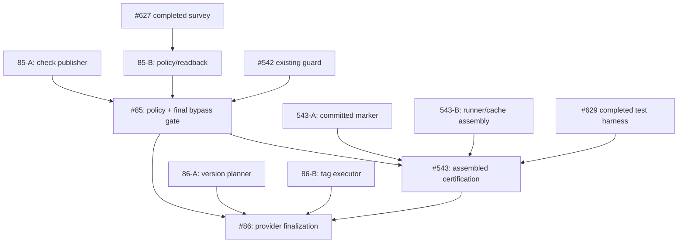

# Remaining-Work Decomposition and Failure-Prevention Audit

Status: proposed, non-authoritative until ticket graph is updated and tested.
Scope: #85, #543, #86, and the source PRs that feed them.
Date: 2026-10-10

## Failure-prevention requirements

The following are mandatory before dispatching parallel workers:

1. Read authoritative issue contracts and the canonical synchronized dependency
   graph.  Check that the actual provider tickets, graph, and descriptions agree.
   Reject missing nodes, reversed or invented dependencies, cycles, duplicate
   direct edges, and accidental transitive serialization.
2. Inventory completed tickets, existing open/draft PRs, file ownership, current
   V3 claims, prior checkpoints, and independently certified acceptance before
   creating any new leaf.  Do not reproduce another owner's implementation.
3. Derive the smallest coherent, independently verifiable behaviours.  Each new
   leaf has precise interface, positive/negative/lifecycle tests, source owner,
   failure/rollback semantics, and a distinct usable DONE artifact.
4. Verify parallelism against *real code and mutable-state surfaces*, not
   merely the appearance of separate nodes in a graph.  In particular, two
   workers editing the same runner or GitHub policy state are not safely
   parallel without explicit nonoverlapping boundaries.
5. Keep actual contract dependencies, but do not turn optional infrastructure
   or future security features into prerequisites.  #97's earlier detour
   through an offline signing ceremony and protected environments illustrates
   this failure.  #85's protected-main requirements are real and remain owned
   by #85, not retroactively imposed on #97.
6. Separate issue-level GREEN from assembled regression, actual hosted provider
   acceptance, branch protection, and final release certification.  Record
   exact SHA, environment, artifact, provider state and which cases are
   incomplete.  Do not interpret inherited #527/#535 renderer evidence failure
   as proof of failure in unrelated source; do not waive it at convergence.
7. An agent must establish and verify a unique V3 claim before source writes,
   keep its existing claim on continuation, and never silently create a
   competing claim or duplicate PR.  A progress update or CI start does not end
   an execution window; measure wall-clock elapsed time and continue actionable
   work, reserving genuine blocks for evidence-backed external limitations.
8. Parent tickets retain all original completion requirements after splitting.
   A small implementation ticket can be DONE independently, but parent
   integration/certification may not be DONE until the real assembled system
   passes its gates.  Speculative downstream work remains BLOCKED until direct
   prerequisites are complete and its assumptions are revalidated.
9. For graph visualizations, use a graph definition rendered by Mermaid, not
   manual positioned SVG lines.  Independently validate node/edge sets,
   reachability to terminal deliverables, arrows and acyclicity.  A connected
   drawing by itself does not prove contractual correctness.
10. Reconcile the agreed capability list with created GitHub issues, canonical
    graph records and actual branch owners before claiming decomposition done.
    Never merge or activate production workflows based merely on a draft plan.

## Evidence of already-owned work

- #627 is CLOSED: GitHub protection capability readback and refusal matrix;
  its provider enforcement cases were explicitly INCOMPLETE where inaccessible.
  Reuse PR #631; do not create another provider survey.
- #629 is CLOSED: 29-case convergence trace, preparatory tests and known
  committed-marker integration defect.  Reuse PR #633 and test-only probes
  #634/#635; they do not certify an assembled #543.
- #542's PR #546 contains premerge and GitHub provider-guard logic; its
  follow-up PR #603 adds a last-moment reread but documents the residual race.
  Do not create an independent second merge-guard owner.
- #85 already has a draft operator checklist PR #607.  Survey and rollout
  documentation do not configure GitHub server protection.
- #541 PR #547 owns unified hosted stages and provider cache reuse; #545 PR
  #552 owns public test CLI.  Do not recreate these as new implementation leaves.
- #543 PR #549 is partial assembled lifecycle certification and #629 provides
  independent preparatory coverage.  Actual convergence is outstanding.
- No current #86 source PR was established by this audit; confirm again when
  workers start before creating a new publisher.

## Suggested remainder (not yet canonical ticket IDs)

### #85: server enforced protected-main integration

- 85-A: exact-candidate required-check publisher: a narrow hosted/provider
  publication implementation, including trust, exact candidate and base
  binding, forged/stale/unavailable evidence rejection.  Only create if not
  owned by an existing PR after searching its patch.
- 85-B: GitHub-native policy rollout and provider readback: one independently
  testable provision/inspect interface plus refusal for unsupported settings,
  using #627's capability matrix.  Do not change production settings as a
  speculative test.
- 85-C: final protection/merge-gate convergence: reuse #542 PR #546/#603;
  execute real provider bypass and changed-base tests, check publisher/policy
  together, and retain #85 as final owner.  Must wait for A and B.

### #543: assembled on-demand CLI/hosted certification

- 543-A: committed invocation / tamper and retry acceptance over assembled
  source.  Reconcile #540's committed HEAD parser with #548; #629 recorded a
  reproducible RED source conflict.
- 543-B: unified stage runner and cache/evidence contract assembly: integrate
  already-owned #541/#545/#548 implementations; do not replace these PRs.
  Verify real immutable artifact reuse and source-change invalidation.
- 543-C: end-to-end certification: run #629's acceptance matrix over actual
  assembled candidate, all stages, three platforms, missing/forged evidence,
  missed-event retry, cost exclusions and #85 server-policy acceptance.
  Retain #543 as final owner.
- Candidate A and B may run in parallel *only* if write ownership and an
  explicit integration surface are disjoint.  Otherwise schedule sequentially
  within the existing #543 owner.

### #86: protected stable-version tag finalization

- 86-A: canonical version, tag collision and immutable tag decision planner
  (read-only; #118 and #80 contract inputs; negative tests).
- 86-B: remote provider finalization executor: only after accepted protected
  server main and authorization evidence; real SHA readback, tag create,
  idempotent retries, immutability/move/delete refusal.
- 86-C: provider-backed final acceptance and cleanup: real sandbox tag
  refusal/race/provider tests and #85/#543 convergence.  Final #86 gate remains
  blocked until both parents DONE.
- Planner and executor may develop separately against a fixed interface; do
  not falsely claim remote finalizer DONE before protected-main integration.

## Proposed dependency shape

All unit labels are provisional.  Existing completed ticket dependencies must
remain canonical.  Avoid duplicating transitive #85 to #86 graph edges unless
#86 independently requires the #85 protected-main interface (it currently
does).  Before creating new tickets: inspect active claims/PR changed files,
freeze actual interfaces and check that each unit is not already implemented.

## Acceptance of this audit

This document is guidance, not a ticket mutation.  It does not itself create
child tickets or update dependency graph state.  Follow TICKET_STATE.md to
create/sync any approved new leaves and verify readback; keep original parent
acceptance criteria unchanged.  No production merge, tag or workflow
activation is authorised by this analysis.

## Completed changed-file ownership audit (PR patch inventory)

This check inspects the **actual changed-file lists** of existing draft PRs,
not just PR descriptions.  It is a stronger ownership check than the initial
specification inventory.  It does not prove a feature is semantically complete;
that requires source-level review and acceptance tests.

| Area | Existing source owner(s) and concrete files | Decision |
| --- | --- | --- |
| Exact candidate eligibility | #104 PR #604: `repo_workflow/candidate_eligibility.py` and its tests | Reuse; no new eligibility leaf |
| Protected merge policy and stale reread | #542 PR #546: `repo_workflow/github_merge_guard.py`, `repo_workflow/pre_merge_gate.py`, `repo_workflow/github_evidence.py`, tests; follow-up PR #603 **also edits the same merge guard** | ONE integration owner; do not split A3 or create another merge guard |
| Protected-main provider capability/readback | #627 PR #631: `scripts/probe-provider-protection.py`, survey and tests; #85 PR #607: rollout checklist | Do not repeat survey/checklist; actual policy configuration/publisher remains unproven |
| Hosted stage runner | #541 PR #547: `.github/workflows/on-demand-ci.yml`, `scripts/on-demand-ci-plan.py`, `scripts/publish-hosted-result.py`, `repo_workflow/ci_invocation.py`, `repo_workflow/github_cache.py`, numerous tests | Reuse; no duplicate hosted-runner leaf |
| Unified CLI and stage engines | #545 PR #552: `repo_workflow/test_cli.py`, `public_cli.py`, `public_commands.py`, `test_cache.py`, `test_red_runner.py`, stage engines and tests | Reuse; no duplicate B1 implementation |
| Shared #541/#545 edits | Both #547 and #552 edit `repo_workflow/test_cli.py`, `public_cli.py`, `public_commands.py`, `test_cache.py`, `test_red_runner.py`, `WORK_GRAPH_METHODOLOGY.md`, `.ci/tests.json` and numerous test files | **Not independent branch-level work.** One controlled assembly owner with conflict-resolution tests is required |
| Cache | #548 PR #615: `repo_workflow/hosted_cache.py`; #541 PR #547: `repo_workflow/hosted_cache.py` and `github_cache.py` | Do not assign independent simultaneous cache writers; #543 must reconcile canonical implementation |
| Independent certification | #629 PR #633: ten test modules, `ISSUE629_CERTIFICATION_MATRIX.md`, fixture; #543 PR #549: `tests/test_on_demand_ci_certification.py` | Existing evidence owners; final assembled provider certification stays #543 |
| GitHub mutation adapter | #97 PR #616 owns `adapters/repo_host_github_*.py` and Python mutation tests | Completed upstream issue; do not regenerate adapter in #85 |
| Stable tag finalizer | None of PR #546/#547/#549/#552/#603/#604/#607/#615/#616/#631/#633/#634/#635 modifies a dedicated finalizer implementation.  #541/#545 touch `repo_workflow/terminal_tag.py`, which is **not** proof of a finished protected stable-tag publisher | #86 remains a real implementation gap, subject to a more targeted full repository search before code changes |

### Revised decomposition decision

1. **Withdraw the naive A1/A2/A3/B1-B5 parallel launch recommendation.**
   Parallel *requirements* do not imply separate concurrent writers when code
   overlaps.  In particular do not create new CLI, cache, merge-guard, provider
   survey, or acceptance-matrix tickets for already owned work.
2. **#85:** the only proposed independently ownable remaining source deliverable
   is a narrow trusted exact-candidate check publisher if source review confirms
   it does not already exist.  Actual GitHub branch protection configuration,
   enforcement readback and bypass certification belong to #85's final owner,
   because they mutate shared remote policy.  A policy provisioning interface
   may merit a separate leaf only after source/policy capability review proves a
   discrete deliverable; no unverified new dependency should be asserted.
3. **#543:** preserve a **single assembled source integration owner** for #541,
   #545, #548 and #542 conflicts, committed-marker reconciliation, cache reuse
   and certification.  A separate read-only independent acceptance worker may
   run #629 tests against a pinned assembled SHA, but must not modify shared
   source.  Do not split overlapping runner/cache edits across concurrent PRs.
4. **#86:** the best potential independent split remains (a) read-only version
   and eligibility planner and (b) remote stable-tag executor.  They can be
   implemented on disjoint modules only after the interface is frozen; final
   provider acceptance still requires #85 and #543.  Do not prematurely add
   either child as a direct parent completion prerequisite before canonical
   ticket graph validation.
5. **Missing evidence:** no source-level semantic review has yet established the
   exact implementation or absence of the required-check publisher or all
   #86 tag finalizer mechanics.  These remain *candidate* child tickets, not
   justified GitHub issue creation.  No child tickets or DAG edges were added.

### Pass/fail verdict on initial proposed launch

**FAIL:** simultaneous implementation of A3/B1/B2/B3/B4 by unrelated workers
would conflict with known existing PR ownership.  **PASS:** preserve one
#85 convergence owner, one #543 assembly owner, one #86 final owner, and reuse
#627/#629 independent evidence.  Proposed narrow publisher and #86 split need
further source- and contract-level verification before dispatch.

## Source-level gap verification and executed decomposition

Observed 2026-10-10, using exact file reads and existing PR diffs:

- #542 PR #546 `repo_workflow/github_merge_guard.py` checks the configured
  status context `repo-workflow/exact-candidate` before protected PR merging.
  This module invokes an evidence gate and the GitHub merge API; it does not
  publish the required named GitHub check.  Existing candidate eligibility
  `repo_workflow/candidate_eligibility.py` on #104 PR #604 is a pure verdict,
  not a GitHub check publisher.  Existing default-branch search for the exact
  required-check name and `create_check_run` returned no matches.  Together
  with the changed-file ownership inventory, this justifies the narrow
  provider check publisher #637.  It is not proof about unsearched private
  branches or out-of-band deployments; #637 must recheck before modifying.
- Main `repo_workflow/guard.py` already implements
  `validate_stable_candidate()`, including stable-version selection,
  authoritative integration-branch HEAD comparison and remote tag collision
  rejection.  Main `repo_workflow/results.py` implements
  `finalize_stable_results()`, including result evaluation and local tag
  creation/push.  `tests/test_stable_release.py` exercises the existing
  version, branch, collision, PASS and FAIL cases.  These do **not** establish
  remote-only, trusted #80 authorization, proven protected-main acceptance,
  atomic immutable stable-tag publication and independently read-back
  provider enforcement.  Consequently a proposed new version planner would
  duplicate source; #638 owns only the missing remote publisher boundary.
- #543 must remain a single source assembly owner because #541 PR #547 and
  #545 PR #552 modify the same public CLI, stage engines, cache, test catalogue
  and docs.  #629 remains independent acceptance evidence, not a competing
  implementation.  No new #543 source child was created.

Created provider tickets:
- #637: Publish GitHub exact-candidate required check from authenticated
  evidence. Direct dependencies #104, #110, #548. Exclusive new publisher
  code; #85 retains policy/readback/bypass certification.
- #638: Implement remote-only stable-tag publisher for accepted main SHA.
  Direct dependencies #80, #118. Exclusive new remote publisher code; #86
  retains final protected-main/convergence provider certification.

Parent provider issues #85 and #86 were amended with their new **direct**
completion edges. Draft PR #636 carries synchronized
`.repoworkflow/tickets.csv` changes. Since main's older CSV lacked recent
#538/#540/#541/#542/#543/#545/#548/#627/#628/#629 records, those were also
added using their authoritative provider titles. #85 depends on
#97/#104/#110/#542/#627/#637; #86 on #80/#85/#118/#543/#638.
#543 remains on #85 and existing CI component prerequisites. Do not treat
closed provider issue status as a substitute for repository lifecycle state.

The committed graph readback has 281 nodes, zero missing references, zero
duplicate direct edges, zero self edges, and zero directed cycles.
This is structural validation, not proof that every historical edge on the
previously incomplete CSV represents the latest provider dependency: all
synchronized issues should be checked against the provider as part of
the full ticket-sync acceptance run.

No new child for #543 and no provider-policy rollout child for #85 were
created: they would duplicate shared source ownership or be inseparable from
the final integration gate. This is an intentional decomposition decision,
not an omitted capability. No merge, release, tag or production activation.

## Stable-tag legacy defects: ownership and required acceptance

Source verification of default-branch `repo_workflow/guard.py` and
`repo_workflow/results.py` found two existing lifecycle defects/risks:

- `validate_stable_candidate()` deletes a pre-existing local stable tag ref,
  violating the expected read-only validation boundary.
- `finalize_stable_results(do_tag=True,push=True)` creates and publishes a
  tag from the local checkout, without exercising the intended remote-only
  authorized publisher of #86. Tag absence checked earlier is vulnerable to
  races; the existing module is not evidence of server-protected publication.

The original version selection and authoritative remote integration-head
checks already exist and should be preserved. #86 **owns regression-first
correction of existing guard/results code**, no extra ticket, including
pre/post local and remote refs, repeated and refused operations, entry-point
migration, and avoidance of an alternate legacy publication bypass. #638
owns only a **new remote-only** atomic create-if-absent publisher and its
independent provider tests; it must not edit guard/results. #86 retains
integration of #638, real provider certification, #80/#85/#543 gates.

Both issue bodies updated explicitly. Canonical dependency edges are unchanged
by this ownership clarification. These are now acceptance requirements, not
claims that implementation has been fixed.
