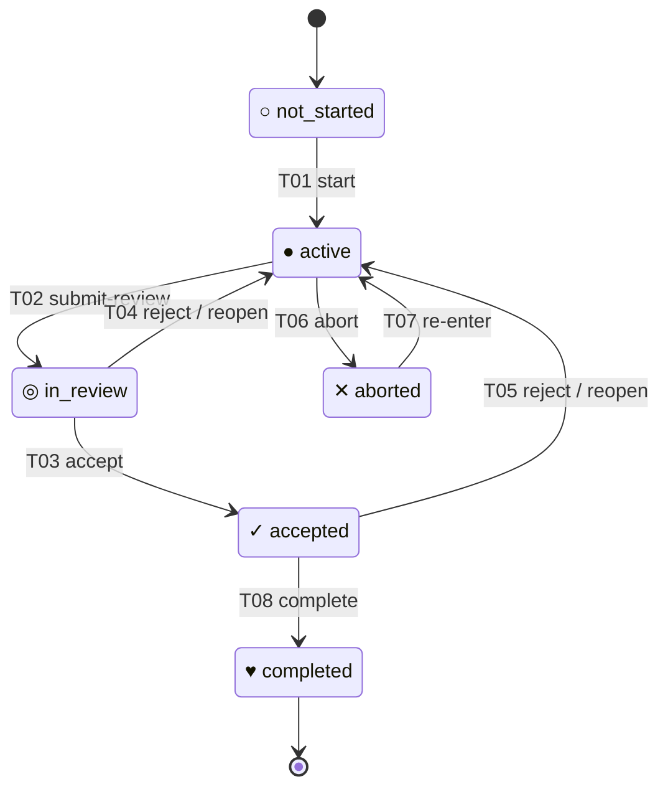

# Six-State Lifecycle Independent Acceptance Matrix

Status: normative black-box acceptance contract for #579 and consumers
#580–#583.  Read with [SIX_STATE_LIFECYCLE.md](SIX_STATE_LIFECYCLE.md),
[ISSUE_LIFECYCLE_STATE.md](ISSUE_LIFECYCLE_STATE.md),
[TICKET_STATE.md](TICKET_STATE.md), and
[STATE_CONCURRENCY.md](STATE_CONCURRENCY.md).

This matrix defines expected observations independently of implementation
details.  It does not assert that a test has passed.  Each implementation
worker must record the exact candidate, test command, and result against
these IDs before declaring acceptance.  Historical schema-1/2 behaviour
is preserved as history; it does not license new schema-3 shortcuts.

## How to read this specification

This is a **test plan**, not a report of executed tests. Each ID names one
requirement-derived acceptance scenario. The **Expected result** column
describes the required behaviour; it must never be filled in from the code
under test. Runtime results remain **INCOMPLETE** until independently run
against an identified candidate and verified from persistent/provider evidence.

| Area | IDs | Cases | What they establish |
| --- | --- | ---: | --- |
| State transitions | T01–T08 | 8 | Allowed transitions and forbidden pairs |
| History and evidence | L01–L20 | 20 | Migration, provenance, acceptance integrity |
| Concurrency and recovery | C01–C13 | 13 | Conflict refusal and durable recovery |
| CSV projection | P01–P18 | 18 | Correct cache, freshness and merging |
| Graph and CLI | G01–G15 | 15 | Display, refresh and public output |
| **Total** | | **74** | **Specification cases, not 74 passes** |

## 1. Transition oracle

### State-transition diagram (same T01–T08 IDs as the table)

The diagram and transition table form one contract: every labelled arrow
corresponds to exactly one row below. The diagram shows allowed state
changes; required evidence and forbidden requests are specified in the table
and the rules following it.

### Transition table (T01–T08)

| ID | Current state | Request | Next state | Required evidence |
| --- | --- | --- | --- | --- |
| T01 | not_started | start | active | Authorized work start |
| T02 | active | submit-review | in_review | Exact submitted candidate; review and validation request |
| T03 | in_review | accept | accepted | Review and validation PASS for the exact candidate |
| T04 | in_review | reject/reopen | active | Rejection or invalidated review evidence recorded |
| T05 | accepted | reject/reopen | active | Acceptance invalidation or rejection recorded |
| T06 | active | abort | aborted | Authorized abandonment; durable reason/evidence |
| T07 | aborted | re-enter | active | Authorized new work generation; history retained |
| T08 | accepted | complete | completed | Current exact-candidate acceptance and separate integration/authorization gates |

All other state/request pairs, including same-state repeats, fail closed
without appending a lifecycle transition.  An exact replay of an already
committed request may return an explicitly proven idempotent result, but must
not create a second event or increment the revision.  A changed request,
candidate, expected revision or underlying evidence is not that replay.
Completion is terminal; there is no implicit reopen from completed.
Abort from in_review first requires a legal return to active.

**Matrix test method:** execute each of the eight requests against each
of the six initial states: 48 pairs.  T01–T08 must produce the listed
successors; the other 40 must preserve state, history and revision and return
a rejected/explicitly proven idempotent outcome.  Test the complete request
shape, including mandatory evidence, in each positive row; reject missing,
stale, mismatched and forged inputs independently.  Verify the authoritative
persisted record after each attempt, not only the return code.

## 2. Lifecycle history and evidence oracle

| ID | Scenario / input | Expected result |
| --- | --- | --- |
| L01 | no record, history proven absent | normalized not_started; no fabricated historical transition |
| L02 | missing record known to have existed | recovery failure, never not_started |
| L03 | schema 1 empty history | read safely; first successful write upgrades to 3 without fabricated events |
| L04 | schema 1 legacy active→accepted | preserve original event names/from/to/sequence; do not invent submit-review |
| L05 | schema 2 with high-risk aliases | preserve sorted aliases, history and issue identity on upgrade |
| L06 | schema 1/2 zero, one and many events | immutable historical prefix, exact sequence continuity and correct legacy_event_count |
| L07 | repeated read/write after upgrade | deterministic round-trip; no spurious event or revision increment |
| L08 | first start→review→accept→complete | four appended events; correct candidate and transitions |
| L09 | review rejection→resubmit→accept | prior rejected evidence retained; only new candidate/current evidence accepted |
| L10 | accepted candidate changed | no completion with stale acceptance; explicit return to active and revalidation |
| L11 | abort→re-enter→abort | both generations visible; never erase abandoned history |
| L12 | illegal transition or failed validation | no fabricated same-state event or lost audit history |
| L13 | provider open/closed × all six states | provider status alone changes neither lifecycle nor dependency satisfaction |
| L14 | completed vs accepted vs aborted | dependency_satisfied true only for completed, independent of local claims |
| L15 | lost clone/worktree/session | committed history reconstructs; no recreated claim/session/current-work ownership |
| L16 | malformed/unsupported/truncated/conflicting history | reject without replacing it with default state |
| L17 | exact candidate mismatch on submit/accept/complete | reject without modifying state, history or revision |
| L18 | changed review/validation evidence after acceptance | stale evidence cannot authorize completion |
| L19 | stale relationship revision when consumed | reject or recompute against a validated new snapshot before publishing |
| L20 | candidate has no required manual test | no invented MIT requirement; all declared ART/AIT evidence still mandatory |

Generic record revisions and provenance belong to the canonical envelope.
History events retain their historical schema representation; normalization
applies to interpretation, not retroactive mutation.

## 3. Concurrency, atomicity and recovery oracle

| ID | Scenario / input | Expected result |
| --- | --- | --- |
| C01 | create from absent record | revision 0 and one canonical issue identity |
| C02 | update at expected revision N | complete next record at N+1; readback matches |
| C03 | stale N after another writer reaches N+1 | conflict; no overwrite, no silent retry |
| C04 | two workers race the same lifecycle revision | at most one publishes; loser rereads/recomputes |
| C05 | independent issues written concurrently | no global issue lock; each CAS independent |
| C06 | crash before atomic record publish | complete old value remains; staged bytes not authority |
| C07 | crash after publish before acknowledgment | replay proves already-applied identity; no duplicate event |
| C08 | multi-record prepared transaction interrupted | prepared is not success; recovery revalidates read set |
| C09 | committed transaction partially materialized | recovery idempotently finishes complete committed successor |
| C10 | aborted transaction | no successor exposed; safe cleanup only of proven staging material |
| C11 | conflicting/changed transaction inputs | fail closed; preserve diagnostic and prior authoritative state |
| C12 | two independent clones publish conflicting revisions | shared integration rejects stale second candidate |
| C13 | writer/session missing or invalid | mutation rejected; no authoritative state change |

An operation must not claim a completed transition on a partially published
multi-record result.  Do not infer global exclusivity from clone-local locks.

## 4. CSV projection and semantic merge oracle

| ID | Scenario / input | Expected result |
| --- | --- | --- |
| P01 | legacy issue,title,dependencies CSV | parsed without invented cached lifecycle state; graph uses ? |
| P02 | initial refresh for zero/one/many rows | five-column canonical header; exact normalized rows/readback |
| P03 | proven absent lifecycle record | not_started with empty state_revision |
| P04 | existing lifecycle record | recognized state and exact sampled authoritative revision |
| P05 | unsupported/empty/malformed migrated state | reject rather than infer a state |
| P06 | mixed revisions across tickets | one validated snapshot; explicitly sampled per-ticket revisions |
| P07 | authoritative state changes after refresh | offline CSV remains an identifiable older snapshot |
| P08 | refresh encounters unreadable lifecycle | no partial CSV write, failure diagnostic |
| P09 | lifecycle changes while refresh reads/publishes | detected conflict/restart, never mislabelled current |
| P10 | concurrent CSV writers | exact read/compare/publish; stale writer rejected |
| P11 | failed CSV write or interrupted publication | previous valid CSV survives; readback before success |
| P12 | provider title/dependency sync | original authority rules retained; no lifecycle mutation |
| P13 | provider closed with RWF active | active retained; no inferred completed state |
| P14 | merge one-sided title/dependency change | existing semantic merge policy retained |
| P15 | divergent state/revision projections | authoritative reconciliation or conflict; no last-writer-wins |
| P16 | stale/unsupported schema on one merge side | fail closed; no silent downgrade to three columns |
| P17 | clone restart and clone-to-clone transfer | committed lifecycle record and cached revision reconstruct exactly |
| P18 | duplicate/unknown issue IDs, invalid dependencies | canonical graph validation fails before committing a projection |

CSV columns are exactly
`issue,title,dependencies,state,state_revision` after explicit migration.
Rows and dependency lists retain canonical numeric order.  The empty revision
exception applies *only* to a proven never-started issue.  A projection is
not an authority for transitions, nor a guarantee of live freshness.

## 5. Graph and public-command oracle

| ID | Scenario / input | Expected result |
| --- | --- | --- |
| G01 | ordinary lanes view/select | cached CSV only; no network/lifecycle read/write |
| G02 | legacy three-column rows | unknown glyph ?; never treat absence as completed |
| G03 | six statuses | ○ ● ◎ ✓ ♥ ✕, each matching its named state |
| G04 | ready and blocked, same state | readiness remains independently derived from direct dependencies |
| G05 | --current with no/one/many displayed nodes | authoritative states refreshed, saved, verified, then rendered |
| G06 | --current provider unavailable | no provider issue-state dependency or implicit remote fetch |
| G07 | --current authoritative error | old CSV unchanged; visible error, no partial graph success |
| G08 | --current plus title/dependency changes elsewhere | state refresh never rewrites titles, dependencies, or topology |
| G09 | --legend absent/present | absent by default; appended six-state legend only when requested |
| G10 | --legend with --json/--count | incompatible non-graph modes rejected |
| G11 | --legend with --current/debug/lane filter | coherent graph first, legend below, no semantic side effects |
| G12 | empty, mixed, long-title and all supported layouts | deterministic spacing, order, and one-cell glyph alignment |
| G13 | monochrome, Linux/Windows terminals | glyphs/unknown marker and accessible labels remain distinguishable |
| G14 | current-worktree pointer differs from graph states | graph renders per-ticket state; navigation pointer not authority |
| G15 | repeated --current with unchanged authority | deterministic serialized projection; no lifecycle mutation |

## 6. Execution evidence ledger — separate from specification

**No test outcome is certified by this document.** The rows above are
requirements and expected results only. When implementation tests run,
record each applicable ID with an exact tested revision and evidence.

| ID | Expected result | Observed result / evidence | Verdict |
| --- | --- | --- | --- |
| T01 | not_started → active | Not executed / no evidence | INCOMPLETE |
| T03 | Matching review evidence required | Not executed / no evidence | INCOMPLETE |
| C03 | Stale update refused; persisted data unchanged | Not executed / no evidence | INCOMPLETE |
| P07 | Old CSV identifiable as a stale snapshot | Not executed / no evidence | INCOMPLETE |
| G05 | --current refreshes, persists and renders | Not executed / no evidence | INCOMPLETE |

The table above **illustrates ledger structure only**; it does not imply
that the other IDs have been executed. For every executed case also store:
exact source SHA, test command and environment, persisted/provider readback,
and a stable evidence URL or artifact identifier.

- **Observed result / evidence:** what was actually seen, plus readback
  proving it. A command exit status alone may be insufficient.
- **Verdict:** `PASS` when observed behaviour satisfies the expected
  result; `FAIL` when it contradicts it; `INCOMPLETE` when execution or
  necessary evidence is missing. Do not fabricate a PASS from the plan.

Independent execution on #580–#583 must trace each applicable expected
observation to its result. Important cross-products: initial state × request
(48 combinations); provider open/closed × lifecycle state; cached revision ×
concurrent update; schema version × event cardinality; graph mode × output.

#579 is specification-only. Accepting the matrix does not authorize
implementation, release tags, a merge or runtime certification.
