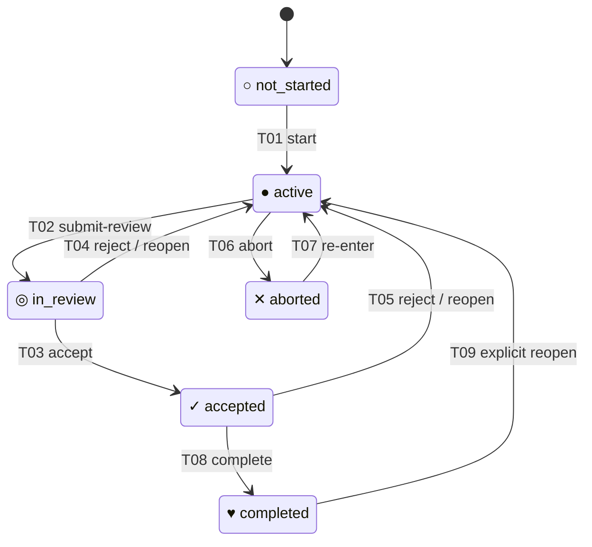

# Six-State Ticket Lifecycle and Graph Status Contract

Status: implementation contract for #577, specified in #579.

## Graph naming

**Lifecycle Graph (LG)** names the six-state RWF dependency view described
here and in [LANE_GRAPH_DISPLAY.md](LANE_GRAPH_DISPLAY.md).  Lifecycle Graph
status comes directly from the ticket state in `.repoworkflow/tickets.csv`.

**Progress Graph (PG)** instead names the four-status, human-facing
**Mermaid** dependency view in
[WORK_GRAPH_VISUAL_CONVENTIONS.md](WORK_GRAPH_VISUAL_CONVENTIONS.md).
The views share dependency relationships but not state labels or colours.
The state-transition diagram in [Transitions](#transitions) documents legal
transitions;
it is distinct from the Lifecycle Graph of issue dependencies.

## Source of truth

`.repoworkflow/tickets.csv` records each ticket's identity, title, dependencies
and current state. Workflow commands update the state cell directly. Readiness
looks up the prerequisite tickets in the same CSV. Git and ticket activity
provide history. Test selection remains in `.ci/tests.json`; existing testing
and integration records identify candidates and results.

## States and status glyphs

| State | Glyph | Meaning |
| --- | --- | --- |
| `not_started` | ○ | No successful work start |
| `active` | ● | Implementation/rework underway |
| `in_review` | ◎ | Review or required validation pending |
| `accepted` | ✓ | Review and acceptance validation passed |
| `completed` | ♥ | Durable workflow completion |
| `aborted` | ✕ | Work abandoned without completion |

`completed` is the sole dependency-satisfying state. `accepted` must not
satisfy a dependency. `ready` and `blocked` remain derived classifications
of `not_started` or `aborted` from direct dependency state; they are not
additional lifecycle states. Glyphs must be one terminal cell, in a
monochrome-compatible presentation, tested on supported platforms.

## Transitions

The Mermaid diagram and the transition table below specify the same nine
legal state changes. Labels T01–T08 link to the independent acceptance
matrix. The initial and terminal markers describe presentation, not extra
public transition operations.

| ID | From | Event | To |
| --- | --- | --- | --- |
| T01 | `not_started` | `start` | `active` |
| T02 | `active` | `submit-review` | `in_review` |
| T03 | `in_review` | `accept` | `accepted` |
| T04 | `in_review` | `reject/reopen` | `active` |
| T05 | `accepted` | `reject/reopen` | `active` |
| T06 | `active` | `abort` | `aborted` |
| T07 | `aborted` | `re-enter` | `active` |
| T08 | `accepted` | `complete` | `completed` |
| T09 | `completed` | `reject/reopen` | `active` |

Only these transitions are legal. A validation failure during active work
records validation evidence without making a fictitious same-state lifecycle
transition. Entry to `in_review` requires an exact candidate and a submitted
review or pending validation request. `accept` requires authoritative
successful exact-candidate review and required validation evidence. Completion
requires the separately defined integration and authorization gates.

An interrupted review must use `reject/reopen` to return to active before
aborting; a new abort transition from `in_review` is not implicit.

## Storage and updates

The CSV columns are `issue,title,dependencies,state`. There is no separate
lifecycle record, revision column, dependency-satisfied flag or transition log.
Updates reject intervening CSV edits and replace the file atomically. Semantic
merging preserves independent edits and reports divergent changes to a state.

Start establishes the branch and version, updates the CSV to `active`, and
selects the issue in the worktree. Completion validates the candidate and
existing test evidence before committing `completed` in the landed CSV.
An already completed ticket requires explicit reopening before another completion.

Graph rendering reads CSV state directly. `--current` no longer copies state
between repository stores. Provider synchronization remains an explicit operation.

## Completed umbrella presentation in the Lifecycle Graph

The human-facing **Lifecycle Graph (LG)** follows the same default umbrella
collapse rule as the PG in
[WORK_GRAPH_VISUAL_CONVENTIONS.md](WORK_GRAPH_VISUAL_CONVENTIONS.md):
the umbrella ticket is always shown as a **ticket node**, including in the
expanded view. Show its constituent sub-ticket nodes while any constituent
is not verified `completed`, the membership set is uncertain, or the
umbrella's own completion remains unverified. When all constituents and
the umbrella are verified `completed`, hide the constituent nodes by default
and show the umbrella alone. Explicit expansion restores all original
tickets and dependency edges.

Preserve external connections by projecting hidden constituent dependency
edges onto the umbrella for display only, with original edge provenance
available in expanded detail. Never create new canonical dependencies.
The LG continues to use its **six lifecycle states and corresponding glyphs**;
do not substitute PG's five work-progress statuses. This presentation rule
does not modify the terminal renderer `rwf lanes view` or its lane colours.

## Verification

Verify CSV state updates, dependency readiness, restart/clone readback,
conflicting edits, semantic merges, graph presentation and real Git completion.
Candidate evidence reuse remains covered by the testing/integration tests.
