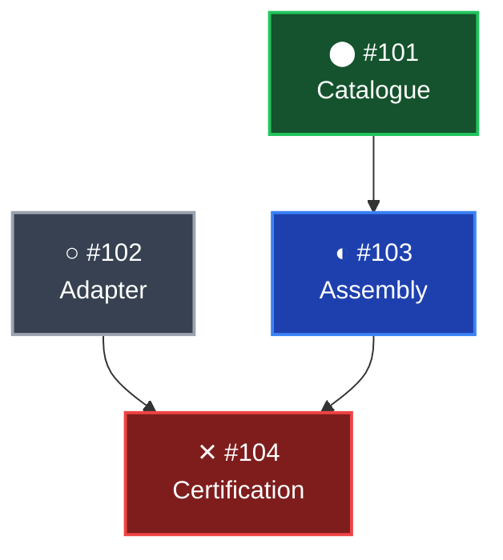

# Dependency Graph Presentation Convention

Status: authoritative visual convention for human-facing **Mermaid** work and
dependency graphs presented in ChatGPT conversations and planning documents.

This is a presentation contract, not an issue-state schema, dependency-graph
mutation, or replacement for RepoWorkflow's terminal `rwf lanes view`.
Terminal-specific lane colours, selection markers, and glyph rules remain
governed by [LANE_GRAPH_DISPLAY.md](LANE_GRAPH_DISPLAY.md) and
[GRAPH_RENDERER.md](GRAPH_RENDERER.md).  A ticket's lane letter or controller
role must not redefine its work-status colour.

## Four-state legend

Use this **exact** project status mapping.  Copy the literal Unicode
characters into the legend and Mermaid node text; do not substitute an emoji,
play button, check mark, smaller bullet, icon-library glyph, or hand-drawn SVG.

| Status | Unicode | Name / code point | Colour | Meaning |
|---|---|---|---|---|
| Done | ⬤ | BLACK LARGE CIRCLE, U+2B24 | Green | Scope accepted |
| In progress | ◐ | CIRCLE WITH LEFT HALF BLACK, U+25D0 | Blue | Actively worked |
| Blocked | ✕ | MULTIPLICATION X, U+2715 | Red | Prerequisite missing |
| Not started | ○ | WHITE CIRCLE, U+25CB | Grey | Ready, not begun |

The three circle symbols deliberately form a readable progression:

```text
○ Not started  ->  ◐ In progress  ->  ⬤ Done
```

`✕` means blocked and sits outside that progression.  Do not replace `◐`
with `▶`: the latter may display as a coloured emoji play button and
visually diverge from the other Unicode text symbols.  `⬤` is intentionally
used instead of the visibly smaller `●` (U+25CF).  Exact pixel dimensions
still depend on the installed font; use one consistent text font and size.
Avoid custom SVG icon artwork.

A blocked item is **red even if preparatory work has started**.  A not-started
item is **grey only if it is currently eligible to begin**; unmet
prerequisites mean blocked/red instead.  Done/green requires completion of
the node's explicitly labelled scope and accepted evidence; a completed
leaf handoff is not proof of a whole parent integration or issue closure.
The blue active status must reflect actual ongoing work, not merely an open
ticket or an existing draft PR.

## Mermaid presentation

Use fenced `mermaid` flowcharts.  Keep nodes legible, maintain dependency
direction from prerequisite to dependant, and use the same characters in
the separate legend and in node labels.  Explicitly define styles for all
four statuses.  Use high-contrast light text on dark node fills and a brighter
status-coloured border, as below.

### Standard colour tokens

| Status | Fill | Border | Text |
|---|---|---|---|
| Done | `#14532D` | `#22C55E` | `#FFFFFF` |
| In progress | `#1E40AF` | `#3B82F6` | `#FFFFFF` |
| Blocked | `#7F1D1D` | `#EF4444` | `#FFFFFF` |
| Not started | `#374151` | `#9CA3AF` | `#FFFFFF` |

Mermaid implementation example:



Use a text legend with precisely the same symbols:

```text
⬤ Done    ◐ In progress    ✕ Blocked    ○ Not started
```

If one issue is shown at more than one **phase** (for example, controller
assembly and final convergence), give those phases distinct Mermaid node IDs
and explicit phase labels.  State that they are two views of the same ticket,
not independent issues or a cycle.

## Evidence and accessibility

- State whether colours reflect a freshly verified canonical ticket snapshot,
  a user-supplied state, or an older checkpoint.  Never silently imply live
  GitHub verification when the graph was not refreshed.
- Distinguish leaf-scope completion from overall integration completion.
  Do not colour a failed or unverified acceptance gate green.
- Encode status using **symbol and colour**.  The legend also spells out
  the status words, so meaning does not depend on colour perception alone.
  Where reading without the legend is important, repeat the status word in
  the node label or adjacent accessible text.
- Symbol shapes must match between legend and nodes.  Avoid SVG/emoji
  substitutions and role-based colours.  For unsupported Unicode fonts,
  prefer adding explicit status words rather than inventing alternate glyphs.
- Graph arrows describe the actual documented dependency relationships;
  the status rendering must never introduce or reverse a graph edge.

This convention applies to **conversation Mermaid dependency diagrams**
independently of the lower-level terminal renderer's current lane-colour
contract.  Changing terminal `rwf lanes view` would be a separate,
explicitly specified implementation task.
