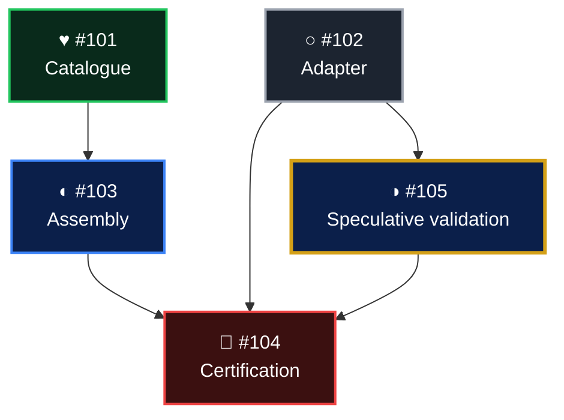

# Dependency Graph Presentation Convention

Status: authoritative visual convention for human-facing **Mermaid** work and
dependency graphs presented in ChatGPT conversations and planning documents.

This is a presentation contract, not an issue-state schema, dependency-graph
mutation, or replacement for RepoWorkflow's terminal `rwf lanes view`.
Terminal-specific lane colours, selection markers, and glyph rules remain
governed by [LANE_GRAPH_DISPLAY.md](LANE_GRAPH_DISPLAY.md) and
[GRAPH_RENDERER.md](GRAPH_RENDERER.md).  A ticket's lane letter or controller
role must not redefine its work-status colour.

## Named graph views

**Progress Graph (PG)** is the human-facing, five-status **Mermaid**
dependency diagram specified by this document.  Its nodes use
`○ Not started`, `◐ In progress`, `◑ Speculative`, `🧱 Blocked`, and `♥ Done` with the
exact colours below.  It describes understandable project progress rather
than formal RWF lifecycle transitions.

**Lifecycle Graph (LG)** is the RWF six-state, lifecycle-annotated dependency
view specified in [SIX_STATE_LIFECYCLE.md](SIX_STATE_LIFECYCLE.md) and
[LANE_GRAPH_DISPLAY.md](LANE_GRAPH_DISPLAY.md).  Its six glyphs are
`○ not_started`, `● active`, `◎ in_review`, `✓ accepted`, `♥ completed`,
and `✕ aborted`.  The `rwf lanes view` terminal graph uses lane-based
colours; `--current` refreshes authoritative lifecycle projections.  The
separate six-state transition diagram in the lifecycle specification shows
legal state transitions; it is not a replacement for the dependency graph.

These are **two presentations of the same dependency relationships**, not
separate dependency graphs or stores.  Their symbols and colouring are not
interchangeable: Progress status is an evidence-based summary; Lifecycle
status follows authoritative RWF state.  Neither view changes state.

Requests may use either full name or the shorthand `PG` and `LG`:

- "Show the Progress Graph for DC #175."
- "Show the Lifecycle Graph for RWF #109."

For an unqualified dependency-graph request in a conversation or planning
document, prefer **Progress Graph**.  Use **Lifecycle Graph** when the
request names it or specifically asks for RWF's formal ticket state or
`rwf lanes view`.  This naming rule does not modify the RWF terminal
command or its output format.

## Five-state legend

Use this **exact** project status mapping.  Copy the literal Unicode
characters into the legend and Mermaid node text.  The Blocked symbol is the
explicitly approved brick emoji.  Do not substitute other emoji, play buttons,
check marks, smaller bullets, icon-library glyphs, or hand-drawn SVG.

| Status | Unicode | Name / code point | Colour | Meaning |
|---|---|---|---|---|
| Done | ♥ | BLACK HEART SUIT, U+2665 | Green | Scope accepted |
| In progress | ◐ | U+25D0 | Blue | Actively worked with all direct prerequisites DONE |
| Speculative | ◑ | U+25D1 | Dark amber border | Authorised bounded work underway while one or more direct prerequisites are incomplete |
| Blocked | 🧱 | BRICK, U+1F9F1 | Red | Prerequisite missing |
| Not started | ○ | WHITE CIRCLE, U+25CB | Grey | Ready, not begun |

The `◐` character is CIRCLE WITH LEFT HALF BLACK (U+25D0).
The `◑` character is CIRCLE WITH RIGHT HALF BLACK (U+25D1).
The outlined and half-filled circles show progression toward a completed
heart; these represent status, not the six-state ticket lifecycle:

```text
○ Not started  ->  ◐ In progress  ->  ♥ Done
```

`🧱` means blocked and sits outside that progression.  The brick may render
as a multicolour emoji and can have different dimensions across fonts and
platforms; never rely on its colour alone.  Do not replace `◐` with `▶`,
which may render as an emoji play button.  The filled `♥` represents
completed work without implying it is a third circular fill state.
Use a consistent text font and size where possible.  Avoid custom SVG icons.

A speculative item is **blue with a dark amber border** only when bounded,
authorised downstream execution is underway against a sufficiently stable,
identified upstream interface and at least one direct prerequisite remains
incomplete.  Such work remains blocked for final acceptance under RWF's
executable dependency semantics.  Once all direct prerequisites are DONE,
the speculative designation ends automatically: show `◐ In progress` if
work remains underway or `♥ Done` when its own acceptance is complete.
A blocked item is **red** when prerequisites remain incomplete and no
independently executable authorised work is underway.  A not-started item
is **grey only if it is currently eligible to begin**.  Done/green requires completion of
the node's explicitly labelled scope and accepted evidence; a completed
leaf handoff is not proof of a whole parent integration or issue closure.
The blue active status must reflect actual ongoing work, not merely an open
ticket or an existing draft PR.

## Mermaid presentation

Use fenced `mermaid` flowcharts.  Keep nodes legible, maintain dependency
direction from prerequisite to dependant, and use the same characters in
the separate legend and in node labels.  Explicitly define styles for all
five statuses.  Use high-contrast light text on dark node fills and a brighter
status-coloured border, as below.

### Standard colour tokens

| Status | Fill | Border | Text |
|---|---|---|---|
| Done | `#092A1B` | `#22C55E` | `#FFFFFF` |
| In progress | `#0B1F4A` | `#3B82F6` | `#FFFFFF` |
| Speculative | `#0B1F4A` | `#D4A017` | `#FFFFFF` |
| Blocked | `#3B1010` | `#EF4444` | `#FFFFFF` |
| Not started | `#1C2430` | `#9CA3AF` | `#FFFFFF` |

Mermaid implementation example:



Use a text legend with precisely the same symbols:

```text
♥ Done    ◐ In progress    ◑ Speculative    🧱 Blocked    ○ Not started
```

If one issue is shown at more than one **phase** (for example, controller
assembly and final convergence), give those phases distinct Mermaid node IDs
and explicit phase labels.  State that they are two views of the same ticket,
not independent issues or a cycle.

## Speculative dependency edge presentation

A dotted Mermaid dependency arrow `-.->` identifies a **canonical direct
dependency** for which the downstream ticket is performing authorised
speculative work before its predecessor is DONE. The downstream ticket is the
owner of integrating its predecessor's final accepted result and carrying its
**own ticket** to verified DONE. The dotted arrow is not a new relationship,
a provisional shortcut, or evidence of completed integration.

**Non-umbrella tickets have uniform incoming arrow styles.** When a
non-umbrella downstream ticket is executing authorised speculative work while
any of its direct prerequisites is unfinished, show **every incoming direct
dependency** as dotted `-.->`, including edges from prerequisites that have
already reached DONE. This is a ticket-level speculative integration state,
not a separate per-edge assertion that each predecessor is unfinished. Once
**all** direct prerequisites reach DONE, show **all** incoming edges as solid
`-->`. The downstream owner must still integrate the accepted inputs and
verify its own DONE before further ordinary dependants advance.

An **umbrella** may display a mixture of dotted and solid arrows **only** as
a projection of dependencies belonging to different constituent sub-tickets.
A mixed umbrella is not a single leaf ticket with mixed execution state.
Preserve which sub-ticket each projected edge represents; expand the umbrella
into its sub-tickets if the mixture would be ambiguous. Umbrella presentation
does not manufacture executable edges or confer eligibility.

Never draw an unverified relationship to explain an assumed handoff.

This is a presentation convention only. No edge is added, removed, reversed,
or weakened in the canonical graph. The normative integration responsibility
and DONE gating are defined by
[WORK_GRAPH_SCHEDULING.md](WORK_GRAPH_SCHEDULING.md).

## Evidence and accessibility

- State whether colours reflect a freshly verified canonical ticket snapshot,
  a user-supplied state, or an older checkpoint.  Never silently imply live
  GitHub verification when the graph was not refreshed.
- Distinguish leaf-scope completion from overall integration completion.
  Do not colour a failed or unverified acceptance gate green.
- Encode status using **symbol and colour**.  The legend also spells out
  the status words, so meaning does not depend on colour perception alone.
  Where reading without the legend is important, repeat the status word in
  the node label or adjacent accessible text.
- Symbol characters must match between legend and nodes.  Apart from the
  explicitly approved brick emoji, avoid alternate emoji, custom SVG icons,
  and role-based colours.  For unsupported fonts, include explicit status
  words rather than inventing alternate glyphs.
- Verify the rendered node interiors visibly retain their specified dark fills
  in both light and dark modes; declarations alone do not establish visible
  rendering fidelity.  The speculative amber border must remain discernible.
- Graph arrows describe the actual documented dependency relationships;
  the status rendering must never introduce or reverse a graph edge.

This convention applies to **conversation Mermaid dependency diagrams**
independently of the lower-level terminal renderer's current lane-colour
contract.  Changing terminal `rwf lanes view` would be a separate,
explicitly specified implementation task.
