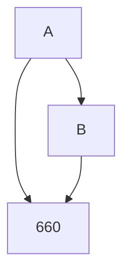

# Workflow in a Nutshell

This document is authoritative. Where other RWF documents conflict with it,
this document wins and the other documents are to be brought into line.

## Files

RWF uses the following repository files, umbrella-branch files and
worktree-local files.

```text
<repository>/
├── .rwf/
│   ├── tickets.csv
│   ├── to-umbrella/
│   │   └── <issue-id>.md
│   ├── repo/
│   │   ├── ci
│   │   ├── tracker
│   │   ├── version
│   │   ├── contact
│   │   └── owner.txt
│   └── ci/
│       ├── rwf                      (CMD branches only)
│       ├── cmd-results.txt          (CMD branches only)
│       ├── testers.txt
│       ├── tests-regression.json
│       ├── tests-integration.json
│       ├── tests-temporary.json
│       ├── tests-temporary/
│       ├── MIT-timeout.txt
│       └── test-results/
│           └── <id-range>/<issue>.jsonl
└── RepoWorkflow
    ├── rwf
    └── repo/
        └── GitHub/
            ├── ci
            ├── tracker
            ├── version
            └── contact

UMBRELLA-<parent-key>             (orphan branch, one per merge destination)
└── .rwf/
    ├── merge-authorise.csv
    └── ci/
        └── queue/
            ├── active/
            ├── queued/
            └── timed-out/

<worktree-git-dir>/
└── rwf/
    └── last-paused.txt
```

`<worktree-git-dir>` is the directory returned by Git for this checkout's
administrative files: normally `.git`, or the associated worktree Git directory
for a linked worktree. These local files are not committed or shared between
worktrees. A worker operating directly through the Git host does not require them.

| File | Purpose |
| --- | --- |
| `.rwf/tickets.csv` | One row per ticket with columns `issue,alias,title,dependencies,state,claimant,bump-ver`. See [Ticket claims](#ticket-claims), [Ticket state](#ticket-state), [Version bump](#version-bump), [Ticket synchronization](#ticket-synchronization) and [Breaking down a ticket](#breaking-down-a-ticket). |
| `.rwf/to-umbrella/<issue-id>.md` | Pending breakdown of a ticket into child tickets. Exists only until all the child tickets have been created. See [Breaking down a ticket](#breaking-down-a-ticket). |
| `.rwf/repo/*` | Repository adapter scripts and the repository owner. See [Repository adapter scripts](#repository-adapter-scripts). |
| `.rwf/ci/tests-regression.json` | Catalogue of regression tests, including each ticket's RED/GREEN test. |
| `.rwf/ci/tests-integration.json` | Catalogue of automatic and manual integration tests. |
| `.rwf/ci/tests-temporary.json` | Catalogue of temporary development tests. |
| `.rwf/ci/tests-temporary/` | Temporary test files. Regression and integration test sources stay wherever the repository's test harness expects them. |
| `.rwf/ci/rwf` | Arguments for the RWF command submitted to CI. Exists only on CMD branches. |
| `.rwf/ci/cmd-results.txt` | Output/result of that CI command. Exists only on CMD branches. |
| `.rwf/ci/testers.txt` | Accepted tester identities. Everyone is currently trusted; the list is not enforced. |
| `.rwf/ci/MIT-timeout.txt` | How long the queue's active PRELIM waits for manual results, in `[[h:]m:]s` format. Absent or empty means zero. Timeout is not test failure. See [Integration Tests](#integration-tests). |
| `.rwf/ci/test-results/<id-range>/<issue>.jsonl` | Append-only test results, one file per ticket, in ranges of 1,000 issue numbers. |
| `UMBRELLA-<parent-key>` | Orphan branch holding the merge authorisations and PRELIM merge queue for one merge destination. See [Umbrella branches](#umbrella-branches). |
| `<worktree-git-dir>/rwf/last-paused.txt` | Line stack of arguments for `rwf resume <ticket-id> [<addendum>]`. Pause appends an entry after successfully checkpointing work. Argumentless resume uses the last entry and removes it only after successful resume. Explicit resume removes its matching entry while preserving the others. |

Each test-result record includes `"source": "<ticket-id>[-<addendum>]"`, tester
identity and the information needed to determine which test, source and
environment it applies to. Copying results preserves their source. Integration
preserves existing records and appends new records from both sides through
RWF's append-aware reconciliation, rather than ordinary text merging.

The current ticket is derived from the current RWF branch name (issue or
PRELIM branch). There is no `current-ticket.txt` or separate persisted
current-ticket selection.

### Branch names

An issue branch is named `issue-<ticket-id>[-<addendum>]--<title>`, where
`<title>` is the ticket's title made safe for a branch name: lowercase words
joined by hyphens, with punctuation removed. The first `--` separates the
stable key `issue-<ticket-id>[-<addendum>]` from the title. An addendum may not
contain `--`; the title may.

RWF identifies a branch only by its stable key; the title is there for people
reading branch lists. When the ticket's title changes, the branch is renamed
to the new title: locally with `git branch -m`, and on the server through the
Git host's branch-rename operation. Renaming changes no commit.

Everything that refers to a branch uses its stable key, never the full name:
identity commits, `PRELIM-issue-<ticket-id>.Q.R[-<addendum>]`,
`UMBRELLA-<parent-key>` and `CMD-<cmd-number>-<source-key>` branches,
`last-paused.txt` entries and queue entries. `main` is its own key.

### Ticket claims

```text
rwf start <ticket-id> [<addendum>] [--user <user>] [--agent <agent-name> <chat-id> [<session-id>]]
```

Start records the invoking user and any supplied AI identity in the `claimant`
column of the ticket's row. The field has the form
`<user>[;<agent-name>;<chat-id>[;<session-id>]]`. Agent name and chat ID are
supplied together; session ID is optional. Without AI arguments, the identity
is the user alone. Use normal CSV quoting when required by the field contents.
A blank `claimant` means the ticket is unclaimed.

This complete field is the claimant identity, also called the worker ID. It
identifies both the user and the AI acting for that user; agent/chat/session
values are not separate claim columns.

Use `--user <user>` when supplied; otherwise resolve the user with
`git config --get user.name` in the target repository. If no nonblank user is
available, `start` errors before creating the branch or changing the claim.
Host-only callers supply `--user` and any `--agent` arguments through `start`;
RWF writes the claimant identity into `.rwf/tickets.csv`. The identity is that
of the implementing user and agent, rather than the CI runner executing the
request.

The normal prescribed issue branch is the claim boundary. A worker checks the
claim, records this identity in that branch's `tickets.csv`,
and publishes the branch using atomic create-if-absent semantics. Competing
creation of the same branch must not overwrite the winner. Updates to an
existing claim use its expected previous branch tip. `start` fails if the
branch already exists; an existing branch is re-entered with `resume`, and
another worker's claim is taken over only with `resume --reclaim` (see
[Pausing a Ticket](#pausing-a-ticket)).

`start` never contacts the ticket server; it works from the local
`tickets.csv`, so it works offline. To start from fresh server data, run
`rwf issue <ticket-id> from-tickets replace` first (see
[Ticket synchronization](#ticket-synchronization)).

If any of the ticket's dependencies are incomplete, `start` and `resume` still
proceed, but warn that a speculative ticket is being started or resumed and
list the incomplete dependencies.

An addendum is an explicitly justified replacement implementation, not an
ordinary parallel claim or an automatic workaround for an existing claim.
The superseded implementation must stop progressing and must not reach `done`;
`merge-authorise.csv` prevents it from merging (see
[Umbrella branches](#umbrella-branches)). The optional addendum precedes the
options; AI identity arguments follow `--agent`.

### Parent identity

`start` creates the issue branch from the current branch. The first commit on
the new branch is an empty identity commit whose message contains:

```text
RWF-Branch: <issue-branch-key>
RWF-Parent: <parent-branch-key>
```

Both values are stable keys (see [Branch names](#branch-names)), so renaming
a branch for a title change does not affect them. Git does not record which
branch a branch was created from, so RWF recovers the parent from this commit:
walk the branch's first-parent history and read `RWF-Parent` from the identity
commit whose `RWF-Branch` equals the branch's key.
If the ticket has an `alias`, the identity commit may name the branch by its
placeholder instead (see [Breaking down a ticket](#breaking-down-a-ticket)).
The identity commit's first parent is the exact commit the branch was created
from. Missing, duplicate or malformed identity commits fail rather than guess.

A ticket's parent is always its nearest enclosing umbrella, never the ticket
that depends on it. A ticket that is not part of an umbrella has `main` as its
parent. A nested umbrella's parent is its own enclosing umbrella.
Dependencies between tickets in the same umbrella only control the order in
which they become eligible to start; they never make one ticket the parent of
another.

### Version bump

The `bump-ver` column holds `patch`, `minor` or `major`: how the stable version
is incremented when the ticket merges into `main`. It is only relevant to
tickets whose parent is `main`; a child merging into an umbrella never merges
into `main` itself, so its `bump-ver` is ignored and may be blank. On the
ticket server it is recorded as a label (for example `bump-ver:minor`). The
server is authoritative: `from-tickets` always pulls it, and `to-tickets` never
pushes it.

For a ticket whose parent is `main`, a blank `bump-ver` is an error. `start`
warns loudly about it. `done` stops with an error before doing anything else,
including before submitting a remote request when invoked as
`rwf done --remote`.

### Ticket state

The `state` column holds one of four values:

| State | Meaning |
| --- | --- |
| `not_started` | No work has started. |
| `active` | Set by `start` and `resume`; work is underway. |
| `completed` | Set by `done` when the ticket merges. Only `completed` satisfies a dependency. |
| `aborted` | Set by `abort`. The branch still exists but work has stopped. |

Progress Graph status is derived from the stored state and the states of the
ticket's dependencies, and is never stored:

| Stored state | Dependencies all `completed` | Progress Graph status |
| --- | --- | --- |
| `completed` | n/a | ♥ Done |
| `active` | yes | ◐ In progress |
| `active` | no | ◑ Speculative |
| `not_started` or `aborted` | yes | ○ Not started |
| `not_started` or `aborted` | no | 🧱 Blocked |

State is synchronized with the ticket server in both directions (see
[Ticket synchronization](#ticket-synchronization)). How each state is
represented depends on the tracker; for example, on GitHub:

| RWF state | GitHub |
| --- | --- |
| `not_started` | Open, unassigned |
| `active` | Open, assigned |
| `completed` | Closed as completed |
| `aborted` | Closed as not planned |

### Ticket commands

```text
rwf abort
rwf reopen <ticket-id>
```

`abort` stops work on the current ticket without completing it and without
discarding its branch, history or test evidence; its state becomes `aborted`.
`reopen` returns a completed ticket to `active`; `done` refuses an already
completed ticket until it is reopened.

### Ticket synchronization

```text
rwf issue [<ISSUE>...] to-tickets (compare|replace (all|dependencies|descendants)...) [ticket-dependencies]
rwf issue [<ISSUE>...] from-tickets (compare|replace) [ticket-dependencies]
```

`to-tickets` pushes `tickets.csv` to the ticket server and `from-tickets`
pulls from it, both through `.rwf/repo/tracker`. `compare` shows the
differences, including placeholder tickets that would be created, and changes
nothing; `replace` applies them.

- `to-tickets` pushes state and dependency links, and creates the tickets for
  placeholder descendants, including their titles, descriptions and
  dependencies. `replace all` does everything; `replace dependencies` and
  `replace descendants` limit it to dependency links or to creating
  descendants. It never pushes titles or `bump-ver`; the server is
  authoritative for both.
- `from-tickets` pulls titles, dependencies, `bump-ver` and state. A title
  change renames the ticket's branches (see [Branch names](#branch-names)).

`<ISSUE>...` is one or more real ticket IDs; placeholders are not accepted.
Without `<ISSUE>`, the nearest ticket at or above the current one that has a
real ID is used: in `660.A` or `660.A.B` that is 660. Syncing a ticket always
creates all of its placeholder descendants. `ticket-dependencies` also
includes every ticket the named tickets depend on, through every level, for
example the whole breakdown under an umbrella.

When `to-tickets` pushes the `active` state, it assigns the ticket to the
account running the push, and posts a claim comment whenever the claimant has
changed since the last one:

```text
RWF-CLAIM

Issue: #<ticket-id>
Claimant: <worker-id>
Started: <timestamp>
Branch: <branch-key>
Parent: <parent-branch-key>
Action: CLAIM|RECLAIM
```

When it pushes the `completed` state, it closes the ticket and posts:

```text
RWF-DONE

Issue: #<ticket-id>
Claimant: <worker-id>
Started: <timestamp>
Done: <timestamp>
Branch: <branch-key>
Parent: <parent-branch-key>
Merge: <merge-commit-sha>
Version: v<version>
```

The timestamps come from Git, not from the time of the push, because `start`
and `done` can run offline. `Started` is the date of the branch's identity
commit, or for a `RECLAIM`, of the commit that changed the claimant in
`tickets.csv`. `Done` is the date of the commit that recorded the ticket as
`completed`.

`start` and local `done` never contact the ticket server. `done --remote`
runs in CI with server access, so it synchronizes the ticket as part of
completion.

Lane selection, lane settings/diagnostics, the Lifecycle Graph and workspace
registry/claim files are excluded from this simplified workflow. Progress
Graphs remain. There is no separate workflow `state.json`, PRELIM checkpoint
store or engine-version file. Additional persistent information requires a
specific workflow purpose and must not duplicate information available from
Git or the existing files.

## Initialisation

### Repository adapter scripts

RWF calls repository-owned scripts in `.rwf/repo/` for
repository/provider-specific work:

| Script | Responsibility |
| --- | --- |
| `.rwf/repo/ci` | CI execution, runner/environment setup, result/artifact transport and CI run status. See [PUBLIC_WORKFLOW.md](PUBLIC_WORKFLOW.md#repo-ci). |
| `.rwf/repo/tracker` | All ticket-server operations: read, list, create, update and comment on tickets, and synchronize titles, dependencies, `bump-ver` labels and state with `tickets.csv`. Nothing more. The GitHub implementation's limits are in [TRACKER_GITHUB.md](TRACKER_GITHUB.md). |
| `.rwf/repo/version` | Read and change the repository version through its defined API. Own the version storage details. See [REPO_VERSION_ADAPTER.md](REPO_VERSION_ADAPTER.md). |
| `.rwf/repo/contact` | `contact <worker-id>` delivers the message read from stdin to that worker, by email or another contact mechanism. `<worker-id>` is `<user>[;<agent-name>;<chat-id>[;<session-id>]]`. Recipient resolution and delivery belong here. |
| `.rwf/repo/owner.txt` | Not a script: contains the worker ID of the repository owner, who is contacted for merges into `main`. |

Branch updates need no adapter: a push of a merge result to the parent is
rejected by Git unless it fast-forwards the parent's current tip.

RepoWorkflow ships example adapters for each supported host under
`RepoWorkflow/repo/<host>/`, for example `RepoWorkflow/repo/GitHub/`. They are
installed with:

```text
rwf init repo <host> [--change]
```

where `<host>` is a directory under `RepoWorkflow/repo/`. It copies that
host's adapters into `.rwf/repo/`. `--change` switches an initialized
repository to another host by copying the new host's adapters over the
existing ones.

References to email below mean notification through `.rwf/repo/contact`.
Repository initialization follows:

```
<user> <system> <repo-dir> (<git-branch>)
$ repoworkflow/rwf init  # initialises RWF files.  Will state how to init for current shell.
To initialise the rwf command for bash, execute this command:

  source <(repoworkflow/rwf init bash)

<user> <system> <repo-dir> (<git-branch>)
$ source <(repoworkflow/rwf init bash)  # initialises auto selection of rwf command and tab completion

<user> <system> <repo-dir> RWF (<git-branch>)
$ 
```

`<user> <system> <repo-dir>` is the regular bash prompt. `(<git-branch>)` is
from git's prompt setup.  RWF doesn't have to do anything with those.

The first part initiates the state of the repo in terms of RWF.  That sets up
the skeleton set of files for the repo.

The second part allows calling the rwf command anywhere in the main repo.
So if `rwf` is called from within `<repo-dir>/some/path`, it'll still call
`<repo-dir>/repoworkflow/rwf`.

The `RWF` in the prompt shows that the bash hooks are active.

## Typical Workflow

```
<user> <system> <repo-dir> RWF (<git-branch>)
$ rwf start <ticket-id> [<addendum>] [--user <user>] [--agent <agent-name> <chat-id> [<session-id>]]

<user> <system> <repo-dir> RWF (issue-<ticket-id>[-<addendum>]--<title>)
$ # branch made from <git-branch>, starting with its identity commit

<user> <system> <repo-dir> RWF (issue-<ticket-id>[-<addendum>]--<title>)
$ # agent creates the RED test (optional) and adds
  # `issue-<ticket>-<regression-test-name>` to the regression catalogue and/or
  # `issue-<ticket>-[manual--]<integration-test-name>` to the integration catalogue and/or
  # `issue-<ticket>-[temp--]<test-name>` to the temporary catalogue.

<user> <system> <repo-dir> RWF (issue-<ticket-id>[-<addendum>]--<title>)
$ rwf test RED # must fail

<user> <system> <repo-dir> RWF (issue-<ticket-id>[-<addendum>]--<title>)
$ # agent implements task

<user> <system> <repo-dir> RWF (issue-<ticket-id>[-<addendum>]--<title>)
$ rwf test GREEN # must succeed, if not go back to "agent implements task"

<user> <system> <repo-dir> RWF (issue-<ticket-id>[-<addendum>]--<title>)
$ rwf test regression [particular-test-ids...] # optional.  If not done, will be done on DONE.

<user> <system> <repo-dir> RWF (issue-<ticket-id>[-<addendum>]--<title>)
$ rwf test integration [particular-test-ids...] # optional.  If not done, will be done on DONE.

<user> <system> <repo-dir> RWF (issue-<ticket-id>[-<addendum>]--<title>)
$ git push

<user> <system> <repo-dir> RWF (issue-<ticket-id>[-<addendum>]--<title>)
$ rwf done --remote

<user> <system> <repo-dir> RWF (issue-<ticket-id>[-<addendum>]--<title>)
$ rwf parent

<user> <system> <repo-dir> RWF (<git-branch>)
$ # back at starting branch
```

`rwf parent` switches to the current branch's parent, as recorded by its
identity commit. It is only permitted when Git can switch branches without
complaint.

## Done

`done` performs these steps in order:

1. If the parent is `main`, fail loudly if the ticket's `bump-ver` is blank.
2. Check the ticket's state in `.rwf/tickets.csv` at destination parent tip A.
   If the ticket is already completed, report an error and stop.
3. Check that the ticket's claimant is authorised to merge into the parent by
   the parent's `merge-authorise.csv` (see [Umbrella branches](#umbrella-branches)).
   If not, fail with an error and contact the parent branch's claimant, or the
   repository owner when the parent is `main`. Nothing is queued or held. Once
   `merge-authorise.csv` is updated, running `done` again is accepted.
4. Create the PRELIM branch at the tip of the parent and prepare its version
   (see [Tests and Versioning](#tests-and-versioning)).
5. Run any outstanding required tests, all automatic tests before any manual
   test. This includes the ticket's temporary tests if they have not already
   passed. Temporary tests and their catalogue entries are left in place so
   they can easily be run again.
6. After required testing passes, record the ticket as completed in
   `.rwf/tickets.csv` and commit that update.
7. Merge into the parent.
8. Create the success version tag on the integrated commit containing the
   completed-ticket record and test evidence.

The order is: test, commit completion, merge, then tag.

The PRELIM branch is named `PRELIM-issue-<ticket-id>.Q.R[-<addendum>]`.
For each ticket, only the latest PRELIM version is ever considered for
testing and merging. Older PRELIM versions are ignored, even when the latest
fails; RWF never falls back to an older one.

Update the parent only if it still points to A. Locally, Git
provides this atomic check and update through `git update-ref
refs/heads/<parent> <C> <A>`; remotely, the push of the merge result is
rejected unless it fast-forwards A. If another integration advances the
parent, recheck the destination ticket state, reconstruct against its new tip
and rerun the invalidated tests before retrying.
Never merge first and roll back afterward. Local completion must also respect
any worktree using the parent: a ref update alone does not update that
worktree's index or files.

If moving to the tip of the parent fails, the agent is signalled by email, so
that they can pull the repo, fix the merge on the latest
`PRELIM-issue-<ticket-id>.Q.R[-<addendum>]`, optionally test it, push
it and then run `rwf done --remote` to have the remaining tests executed.

Test results are only used for validation when the tester is trusted. For now,
everyone is trusted. Security work is deferred.

If remaining tests done on server show failure, the agent will be contacted by
email, or the agent can look at the test results using `rwf test results
issue-<ticket-id> [--remote [--poll [<seconds> ...]]]`.  Without `--remote` it
reports the local test results.  On test failure, just like merge failure, agent
will edit the latest `PRELIM-issue-<ticket-id>.Q.R[-<addendum>]`, push it
and then submit `rwf done --remote`.

`rwf fix <ticket-id> [<addendum>]` makes it easy to come back to the latest
PRELIM branch. E.g.

```
<user> <system> <repo-dir> RWF (<git-branch>)
$ git pull

<user> <system> <repo-dir> RWF (<git-branch>)
$ rwf fix <ticket-id> [<addendum>]

<user> <system> <repo-dir> RWF (PRELIM-issue-<ticket-id>.Q.R[-<addendum>])
$ # Q.R are the latest ones.

<user> <system> <repo-dir> RWF (PRELIM-issue-<ticket-id>.Q.R[-<addendum>])
$ rwf test results  # optionally look at the test results locally.

<user> <system> <repo-dir> RWF (PRELIM-issue-<ticket-id>.Q.R[-<addendum>])
$ # do fixes.

<user> <system> <repo-dir> RWF (PRELIM-issue-<ticket-id>.Q.R[-<addendum>])
$ git push

<user> <system> <repo-dir> RWF (PRELIM-issue-<ticket-id>.Q.R[-<addendum>])
$ rwf done --remote
```

Note that `<repo-dir>` can be any directory within the repo's directory.

An agent authorised to merge into the local parent can use `rwf done` offline
instead of `git push` followed by `rwf done --remote`.

After successful integration, retire the processed PRELIM branch, delete the
CMD branches whose source is the ticket's issue or PRELIM branches, and retain
test evidence in repository history. `done --remote` then synchronizes the
completed ticket with the ticket server. Local `done` does not contact the
ticket server; the completion is pushed by the next `to-tickets` (see
[Ticket synchronization](#ticket-synchronization)). Report any unfinished tag
creation or PRELIM retirement explicitly. Retrying these finishing steps must
not merge the ticket again.

### Remote done

`rwf done --remote` is the only remote command whose execution differs from
its local form. It performs the same checks as local `done`, then wraps local
`done` with the PRELIM queue and MIT deferral and timeout handling described
under [Umbrella branches](#umbrella-branches) and
[Integration Tests](#integration-tests).

When manual tests are needed, the manual tester is contacted. The tester pulls
the PRELIM branch, runs the manual tests, reports `rwf test succeeded` or
`rwf test failed` for each, pushes the results and submits `rwf done --remote`.
This is the only reason a further `rwf done --remote` is needed.

## Umbrella branches

Every merge destination (parent branch) has an orphan branch named
`UMBRELLA-<parent-key>`. Being an orphan, it shares no history with the
code and can never be merged into it. `main` is treated as an implicit
umbrella and has `UMBRELLA-main`.

A ticket becomes an umbrella when `rwf umbrella make` creates its UMBRELLA
branch (see [Breaking down a ticket](#breaking-down-a-ticket)); the existence
of that branch is the only record that the ticket is an umbrella. `rwf init`
creates `UMBRELLA-main`. Both use atomic create-if-absent.

When the umbrella ticket itself completes, its `done` errors if anything
remains in its queue, and otherwise deletes its UMBRELLA branch.
`UMBRELLA-main` is never deleted.

An UMBRELLA branch whose name contains a placeholder is renamed when the
placeholder is replaced by a ticket ID, along with the ticket's own branches,
in the same way as for a title change (see [Branch names](#branch-names)).

### Merge authorisation

`.rwf/merge-authorise.csv` on the UMBRELLA branch lists which tickets may
merge into that parent, with columns `ticket-id,addendum,claimant`. `addendum`
and `claimant` may be blank. A blank `claimant` authorises whoever is the
ticket's claimant in `tickets.csv`; a non-blank one authorises only that
claimant identity. `done` checks the ticket's claimant in `tickets.csv`, not
the identity of whoever invokes `done`, so a tester submitting `done --remote`
after recording manual results is accepted.

### PRELIM queue

`.rwf/ci/queue/` on the UMBRELLA branch holds one empty file per queued
PRELIM, named after the PRELIM branch:

| Directory | Contents |
| --- | --- |
| `active/` | Zero or one PRELIM currently being processed. |
| `queued/` | PRELIMs waiting to be processed. |
| `timed-out/` | PRELIMs whose manual-test wait expired. |

Queue transitions are file moves committed to the UMBRELLA branch:

1. `done --remote` adds its PRELIM to `queued/`, unless it is already present.
2. When `active/` is empty, a randomly selected entry moves from `queued/` to
   `active/`. Only the active PRELIM is tested, so time isn't spent on
   candidates whose results would be invalidated by the next merge.
3. On successful merge the active entry is removed. When its wait for manual
   results expires, it moves to `timed-out/`.
4. When `queued/` is empty, all `timed-out/` entries move back to `queued/`,
   so none are forgotten.

A delayed CI wake-up continues processing after a timeout without keeping a
runner busy. There is at most one pending wake-up per parent; a new
`done --remote` for the same parent replaces it. A wake-up rechecks the
queue's current state before acting.

## Breaking down a ticket

```text
rwf umbrella make [<filename>|--stdin]
rwf umbrella edit [<issue-id>]
```

`umbrella make` converts the current ticket into an umbrella by creating its
UMBRELLA branch, and breaks it down into child tickets described by a graph
file. It only changes files: it writes the graph file to
`.rwf/to-umbrella/<issue-id>.md`, adds each child to `tickets.csv` and to the
new UMBRELLA branch's `merge-authorise.csv` under its placeholder ID, and
commits. The tickets themselves are created on the ticket server later by
`to-tickets` (see [Creating the tickets](#creating-the-tickets)).

Like `git commit`, it builds the file from two templates:

- With `<filename>` or `--stdin`, that input followed by the instructions
  template is written to `.rwf/to-umbrella/<issue-id>.md`.
- With neither, the graph template followed by the instructions template is
  written there, with the ticket ID filled in, and opened in Git's configured
  editor (`git var GIT_EDITOR`).

If the file contains only whitespace once HTML comments are removed, it is
deleted and nothing else changes. Otherwise it is verified before the command
returns (see [Creating the tickets](#creating-the-tickets)); a failure is
reported loudly with a specific error message.

`umbrella edit` reopens a pending breakdown file in the editor and verifies it
again when the editor closes. `<issue-id>` defaults to the current ticket. It
is only possible while the file is pending, and only placeholder nodes may be
changed; nodes that already have ticket IDs exist on the server. Changed
titles are written to `tickets.csv` when the editor closes.

Graph template:

````markdown
<!--
## Graph
```mermaid
graph TD
  A --> <ticket-id>
  B --> <ticket-id>
  A --> B
```

## Node A
<title>

<description>

## Node B
<title>

<description>
-->
````

Instructions template:

```markdown
<!-- The DAG must have no cycles and each node must have a path to
     <ticket-id> -->
```

An umbrella is implemented in rounds: the children whose dependencies are
complete are started from the umbrella's current tip, implemented and merged
into the umbrella, and then the next ready children are selected, until the
umbrella is finished.

A child may also be started speculatively, before its dependencies are
complete; `start` warns that it is speculative and lists the incomplete
dependencies (see [Ticket claims](#ticket-claims)). It also starts from the
umbrella's current tip, so it does not yet contain its dependencies' work, and
picks that work up when it is reintegrated with the umbrella's tip after they
merge.

### Graph file

````markdown
## Graph


## Node A
<title>

<description>

## Node B
<title>

<description>
````

- The `## Graph` section is a Mermaid graph whose edges funnel into the ticket
  being broken down. Its node IDs are placeholders, one per new ticket.
- Each node has a `## Node <id>` section. Its first line is the ticket's
  title; the rest is the description.
- The graph is self-contained: it does not refer to existing tickets other
  than the one being broken down.
- Every node is a child of the ticket being broken down: it branches from, and
  merges into, that ticket's branch. Edges between nodes are ordinary
  dependencies that only control order.
- Any child can later be broken down into its own umbrella with
  `rwf umbrella make` on that child. The original graph does not show this.

### Placeholders

Placeholder IDs are qualified by the ticket being broken down and use
spreadsheet-style uppercase names at each level, separated by dots: `660.A`,
`660.B`, … `660.Z`, `660.AA`, and so on. A ticket broken down while it still
has a placeholder ID nests another level, e.g. `660.A.B`. Uppercase only
avoids branch-name collisions on case-insensitive filesystems.

Placeholder rows are added to `tickets.csv` so work can continue offline, and
a placeholder ticket may be started. A `git push` should preferably not be
done until its tickets have been created on the tracker.

When a placeholder is replaced by a real ticket ID:

- Every reference to it in `tickets.csv` and in the umbrella's
  `merge-authorise.csv` is replaced.
- If the ticket was already started under its placeholder, its `alias` column
  records the placeholder, because its branch's identity commit still names the
  placeholder. Parent lookup and the `tickets.csv` merge driver match on
  `alias`. A ticket created on the tracker before it was started has a blank
  `alias`.
- Its branches (issue, PRELIM and UMBRELLA) are renamed. On the server the new
  names are pushed and the placeholder-named branches are deleted.

### Creating the tickets

`umbrella make` and `umbrella edit` verify the whole file: the graph has no
cycles, every node has a path to the ticket being broken down, every node has
a section with a title, and no node refers to an existing ticket other than
the one being broken down.

The tickets are created by `to-tickets` (see
[Ticket synchronization](#ticket-synchronization)):

1. For each node, mark its heading as `## Node <id> - ticket creation
   attempted`, then create the ticket through `.rwf/repo/tracker`. On a retry,
   a node marked as attempted is first looked up on the server by its exact
   title and only created if it is not found.
2. As each ticket is created, replace its placeholder with the ticket ID in
   the file, in `tickets.csv` and in the umbrella's `merge-authorise.csv`.
3. When every ticket exists, synchronize the dependencies, append the
   breakdown note to the umbrella ticket's description, delete the pending
   file and commit.

If the tracker is unreachable, the partly converted file stays in place, and
a later `to-tickets` or `done --remote` resumes it.

### Breakdown note

The note is appended to the end of the umbrella ticket's description, not
added as a comment. It contains:

- The Mermaid graph, with each node labelled `<id> - <title>`, the title
  truncated to about 10–15 characters at a word boundary and ending with `...`
  when shortened. Where the tracker renders Mermaid links and tooltips, each
  node links to its ticket and shows the full title on hover.
- A list of the child tickets, one `#<id> - <title>` per line, so that links
  and full titles are available even where the graph cannot link.

## Remote Commands

Only `--remote` commands ever trigger execution. An ordinary push never does.

Remote-capable commands can take `--remote [--poll [<seconds> ...]]` which
updates the `.rwf/ci/rwf` file, which triggers a CI action.  The `.rwf/ci/rwf`
file contains the parameters to `rwf` and adds a `n` item to the `--remote`
switch.  E.g. `rwf <some-command> --remote [--poll [<seconds> ...]]` will
result in `.rwf/ci/rwf` containing `<some-command> --remote n`, where `n` is the
retry number starting at `0`. `--poll` is client-side and is not recorded.

`--poll` checks immediately and then waits between status checks. Supplied
seconds are successive delays: `--poll 5 15 60` waits 5 seconds, then 15,
then repeats 60-second delays until completion. With no numbers, `--poll`
uses 15-second delays. Without `--poll`, submission returns without waiting.
These delays are separate from the manual-test timeout.

The status of a previously submitted command is read without resubmitting it:

```text
rwf remote-status [<cmd-number>] [--poll [<seconds> ...]]
```

Without `<cmd-number>`, it reports the most recent command.

`parent`, `resume`, `fix`, `pause`, and shell activation are local-only.
They reject `--remote` with an explanation that the operation acts on the
caller's local checkout or shell. Their help and tab completion do not offer
`--remote` or its dependent polling options. The commands remain available locally.

All remote commands are put in a CMD branch off the tip of the branch to
execute from (the source branch). The CMD branch is named
`CMD-<cmd-number>-<source-key>`, using the source branch's stable key. The CI enters from the CMD branch, reads
the command from `.rwf/ci/rwf`, switches to the CMD branch's parent (the
source branch) and executes the command there. The execution may mutate the
source branch, for example by committing test results, which is why the CMD
branch MUST be rooted at the tip of the source branch. The command's output
and result are stored in `.rwf/ci/cmd-results.txt` in that CMD branch.

## Testing

Tests are declared in `.rwf/ci/tests-regression.json`,
`.rwf/ci/tests-integration.json` or `.rwf/ci/tests-temporary.json`. The
catalogues determine which tests exist and which regression, automatic
integration or manual integration selection they belong to. RED/GREEN is a
development use of a regression test, not a separate test category or
catalogue.

Tests may run individually or in groups, locally or through supported remote
commands. Applicable results already recorded for the same source, test inputs
and environment can be reused. Required tests without applicable passing
results remain outstanding and are run during completion, including on the
server when deferred. An applicable failure prevents merge.

By default all selected tests are run, regardless of failures. Add
`--stop-on-fail` to stop at the first failure, e.g.
`rwf test --stop-on-fail (regression|integration) [particular-test-ids...]`.

A test that cannot be run, for example because of a parse or build error or
an infrastructure failure, is INCOMPLETE. An INCOMPLETE result gets no version
id or tag.

Results are appended to `.rwf/ci/test-results/<id-range>/<issue>.jsonl`, with
the originating `source`, tester identity, tested source and relevant test and
environment information. Remaining tests and outcomes are determined from the
catalogues and these logs, without a separate pending-results file. AIs are
trusted for now. `.rwf/ci/testers.txt` describes accepted testers when that
policy is applied; ticket ownership and test-result attribution remain distinct.

### Temporary Tests

Temporary tests support development or diagnosis and are registered in
`.rwf/ci/tests-temporary.json`. Their files live in
`.rwf/ci/tests-temporary/`. Run them with `rwf test temporary`.
`done` runs the current ticket's temporary tests if they have not already
passed, and leaves them in place afterwards. Permanent regression tests belong
in their permanent location and catalogue from creation; they must not be
placed in the temporary directory.

### Regression Tests

Regression tests check required behavior and protect it against later changes.
Register them in `.rwf/ci/tests-regression.json`.

Each ticket should define one focused RED/GREEN regression test. Needing
multiple independent tests is a reason to revisit ticket decomposition;
combining independent tests inside one test to disguise that need is not
acceptable. Existing required regression and integration coverage still runs.

The ticket's RED/GREEN test is its single `issue-<ticket-id>-<description>`
entry in `.rwf/ci/tests-regression.json`. `rwf test RED` and `rwf test GREEN`
take no test name; they error if the ticket has no such entry or more than one.

The optional RED/GREEN development sequence is:

1. Write and register the regression test for the intended behavior.
2. Run `rwf test RED` before the implementation. Confirm the expected failure,
   rather than a runner error.
3. Implement the change.
4. Run `rwf test GREEN`. Fix the implementation until the test passes.

Skipping RED/GREEN does not exempt any required test from final validation.
The same tests participate in regression testing afterward.
`rwf test regression [particular-test-ids...]` runs the selected regression
tests, or the full regression selection when IDs are omitted. Partial passing
runs can collectively satisfy coverage when their evidence remains applicable.

### Integration Tests

`rwf test integration` runs integration tests only; it does not also run
regression tests.

If doing integration testing and there are manual tests, then it should look like this:

```
<user> <system> <repo-dir> RWF (issue-<ticket-id>[-<addendum>]--<title>)
$ rwf test integration [--manual|particular-test-ids...]

# Runs integration tests.  Automated first, manual second.
# On running a manual test, will wait for completion.
# A is the current number of manual tests already reported succeeded or failed.
# B is the total number of manual tests to be done.

<user> <system> <repo-dir> RWF MIT A/B (issue-<ticket-id>[-<addendum>]--<title>)
$ rwf test [succeeded|failed]
```

Manual integration tests are named `issue-<ticket-id>-manual--<description>`.
A manual test declares a command that RWF runs, typically bringing up a GUI;
RWF waits for it to finish and returns to the prompt, where the tester reports
the outcome.

To only run the automated integration tests, do the following:

```
<user> <system> <repo-dir> RWF (issue-<ticket-id>[-<addendum>]--<title>)
$ rwf test integration --automatic
```

Counting the tests can be done by:

```
<user> <system> <repo-dir> RWF (issue-<ticket-id>[-<addendum>]--<title>)
$ rwf test integration [--manual|--automatic|particular-test-ids...] --count
```

Remote `done` completes all required automatic tests before emailing the manual
tester. The queue's active PRELIM waits for manual results for the duration
configured in `.rwf/ci/MIT-timeout.txt`, using `[[h:]m:]s`: `45` is 45 seconds,
`2:30` is 2 minutes 30 seconds, and `1:02:30` is 1 hour 2 minutes 30 seconds.
On expiry, the PRELIM moves to `timed-out/` so other submissions progress. It
stays unmerged until its required manual results pass; timeout is not test
failure.

An absent or empty timeout file defaults to `0`. In CI, zero moves the PRELIM
to `timed-out/` without waiting while preserving the outstanding manual-test
obligation. For local execution outside CI, return to the `[MIT A/B]` shell
prompt so the tester can perform and report the manual tests.

## Pausing a Ticket

This is similar in purpose to git stash, but the work is saved as an ordinary
commit on the issue branch.

```
<user> <system> <repo-dir> RWF (issue-<ticket-id>[-<addendum>]--<title>)
$ rwf pause [-u|--include-untracked|-a|--all]

<user> <system> <repo-dir> RWF (issue-<ticket-id>[-<addendum>]--<title>)
$ rwf parent

<user> <system> <repo-dir> RWF (parent-branch)
$ # do what needs to be done

<user> <system> <repo-dir> RWF (parent-branch)
$ rwf resume [<ticket-id> [<addendum>]] [--user <user>] [--agent <agent-name> <chat-id> [<session-id>]] [--reclaim]

<user> <system> <repo-dir> RWF (issue-<ticket-id>[-<addendum>]--<title>)
$ # back to where you were.
```

`pause` creates exactly one commit at the branch tip, marked with
`RWF-Pause: 1` in its message. Plain `pause` saves staged and unstaged changes
to tracked files; `-u`/`--include-untracked` also saves untracked files;
`-a`/`--all` also saves ignored files. A clean worktree produces an empty
pause commit. The pause commit is ordinary branch history that travels with
push and fetch. `pause` stays on the issue branch; use `rwf parent` to switch
away. After a successful pause, the arguments for resuming it are appended to
`<worktree-git-dir>/rwf/last-paused.txt`.

`resume` switches to the existing issue branch and continues from its tip. It
does not decode, remove or restore the pause commit, and the pre-pause
staged/unstaged distinction is not restored. Without arguments, it resumes the
last entry in `last-paused.txt`. `resume` fails if there is no branch to
resume.

`resume` fails if the resuming identity differs from the ticket's claimant,
unless `--reclaim` is given, which replaces the claimant. `--reclaim` also
fails if the identity is the same as the current claimant.

`start` fails if the branch already exists; use `resume` instead.

## Tests and Versioning

Tests can run individually or as a group. Initialize `Q=0, R=0` before the
ticket's first test. Before testing a changed implementation, increment Q once
and reset R to zero. Reintegrating unchanged implementation against a newer
parent increments R. If both change, increment Q and reset R to zero.
Additional tests, unchanged retries and test-log-only commits reuse the
prepared version without incrementing either counter.

When `done` prepares a PRELIM for merging into an umbrella, it reads the
parent's version and increments it (Q+1, R=0), and the merge result carries
that version. Each child would otherwise set the shared version to its own
issue number, either relabelling the umbrella or conflicting with other
children. When the destination is `main`, the stable version is incremented
according to the ticket's `bump-ver` value instead. Both happen when the
PRELIM is prepared, before its tests run.

The test results are committed in the repo under
`.rwf/ci/test-results/<id-range>/<issue>.jsonl`.  The `<id-range>` is to prevent
overfilling a directory with files causing performance issues and/or failures.
Each range spans 1,000 issue numbers: `0-999`, `1000-1999`, and so on.
For example, issue 109 uses `0-999/109.jsonl`.

Each JSONL test-result record contains `"source": "<ticket-id>[-<addendum>]"`,
identifying the originating ticket and optional addendum. This remains the
same when its results are copied or integrated into another branch.

On test failure, record the failure tag `v<version>-CI-FAIL`.
Create the success tag `v<version>` after successful integration, following
the test, completion commit, merge and tag order under [Done](#done).
Version preparation changes version data through `.rwf/repo/version`; it must
not change implementation code. Recording completion and creating the tag do
not require repeating tests for the unchanged implementation.
